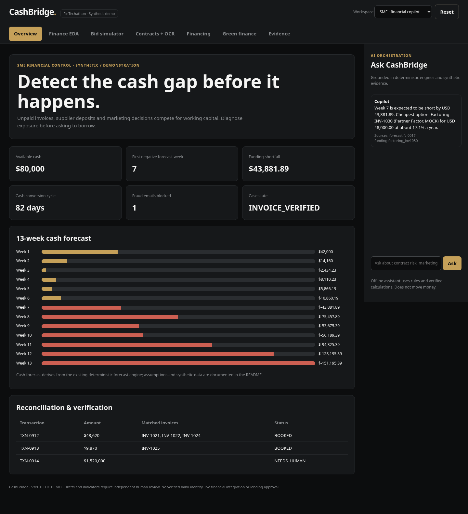
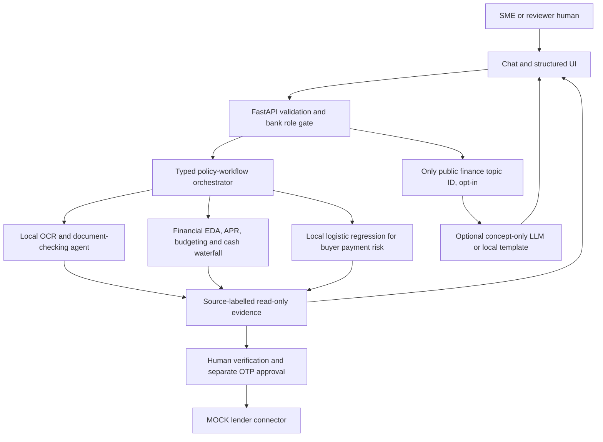

# CashBridge

**AI-powered SME financial decision & financing readiness copilot — from working-capital pressure and marketing budgets to credible green-transition financing preparation.**

Built for the 2026 Shenzhen International FinTech Competition, International Track, Topic E (SME Finance Copilot).
Every company, person, buyer, lender and API in this repository is **SYNTHETIC** or **MOCK**.



## Privacy-first update: multi-agent workflows with NO LLM orchestration

**The control-plane architecture has been changed after the October evaluation.** The LLM no longer chooses tools, performs extraction, drafts funding letters from private inputs, makes lending decisions or sees SME/Bank documents. A **server-side policy workflow** selects a fixed allowlist of local specialist analytical agents from explicit workflow IDs and validated structured input fields. The original synthetic buyer-risk logistic regression and deterministic cash-flow, APR, invoice and budget engines remain in use. The CFO chat now uses local, constrained read-only explanations. An **optional human-facing concept explainer** accepts only fixed PUBLIC finance topics; it is **off by default** and never receives arbitrary chat text, contracts or case data.

This package also includes `POST /api/copilot/ask` (deterministic multi-step agent trace), `POST /api/projects/waterfall` (strict time-indexed receipt/cost schedules), `POST /api/contracts/draft-docx` (unsigned DOCX draft), and **server-side token authorization** for `GET /api/bank/review`. The packaged zero-build UI supports the policy workflow and bank unlock screen. See [privacy-first architecture, threat model and exact API examples](docs/PRIVACY_FIRST_AGENT_ARCHITECTURE.md).

> All sensitive SME data remains local in this synthetic MVP; this is **not a production security certification**. Other SME routes still lack user/tenant authentication and should never receive real customer information.

## Who it serves — the financial pressure behind every SME decision

SMEs may be profitable yet struggle to cover supplier deposits, payroll and overdue receivables. They must also choose how much they can safely allocate to marketing, equipment, expansion and green upgrades while preserving a liquidity buffer. Financing is difficult to compare, documents take time to prepare, and banks need consistent supporting evidence.

**CashBridge supports better capital decisions before suggesting borrowing:** anticipate liquidity pressure, simulate spending trade-offs, verify receivables, compare financing costs, and assemble a traceable funding pack. A preliminary green-finance pathway helps SMEs organize evidence for investments like solar installations and energy-efficient machinery, while banks retain all lending decisions.

### Application scenarios

| SME challenge | CashBridge workflow | What the current MVP actually supports |
|---|---|---|
| Tight working capital and delayed buyers | Predict cash pressure, examine buyer risk, compare factoring/loans | 13-week forecast, buyer-risk demo and funding APR comparison |
| Uncertain marketing budget during expansion | Protect minimum cash reserve and test marketing-vs-core-spending trade-offs | **Capital Planner** deterministic what-if simulation; not marketing ROI prediction |
| Large upfront green equipment cost | Compare investment outlay with available cash and examine green-project evidence | Capital Planner + **Green Finance** document completeness and illustrative impact |
| Loan documentation burden | Reconcile receivables and prepare traceable documents | Invoice/PO/B-L checks, evidence pack, OTP approval; lender submission is MOCK |
| Bank assessment workload | Present normalized evidence and identify exceptions | Token-gated demo reviewer view (not a production bank identity system or credit approval engine) |

### October 2026 — AI financial & contract intelligence update

Alongside the original 13-week liquidity workflow, this package now includes **working Python endpoints, source-labelled synthetic data, tests, and SME/Bank preview interfaces**:

| Feature | Implemented behavior | Caveat |
|---|---|---|
| Financial Intelligence / EDA | Nine financial ratios, 12-month monthly ledger, z-score expense outliers and funding/marketing scenario | DSCR is a proxy; synthetic historical data; no automatic ROI modeling |
| Project / Bid Risk Simulator | Upfront cash gap, delayed-advance + overrun stress, indicative margin and aggregated workforce gap/cost | Simplified, does not evaluate employees or decide a bid |
| Contract / Invoice Intelligence | Text PDF + local image OCR, USD amount extraction, milestone review, suspicious clause flags, invoice reconciliation | Pattern-based evidence prompts, not fraud proof or legal authenticity |
| Agreement drafting | Supply / service / construction service unsigned templates, validated milestone math, legal-review checklist, TXT export | Draft only; unsigned DOCX export exists; no e-signature or legal authorization |
| Green-investment economics | Synthetic energy saving and simple payback with explicit price / opex assumptions | Not environmental certification or underwriting |
| SME / Bank reviewer views | Two presentation workspaces with shared deterministic engines and human-review checklist | **Bank API now has a server-configured token; still no production identity or per-tenant access control** |
| Conversational tools | Offline CFO shortcuts for contract-review summary, marketing impact and finance ratios; original CFO intents retained | Controlled local chat; LLM tool planning is intentionally disabled |

The archive includes an **offline zero-build dashboard** (`ui/web/dist/`) that calls real FastAPI endpoints. The more extensive React/TypeScript source (`ui/web/src/`) is supplied as well; with Node/network access, run `make ui` to compile it. The bundled dashboard was exercised in a Chromium browser harness against the in-process FastAPI API, and new screenshots are provided under `docs/screenshots/06–11` (the React build itself was not verified offline). See [implementation notes](docs/INTELLIGENCE_EXTENSION.md) and [3-minute demo story](docs/FINTECHATHON_DEMO_STORY.md).

### What's new in the earlier green/capital extension

- **Capital Planner** tab: editable cash, reserve, working capital, marketing and green-investment budgets; server-side cash-gap simulation and marketing-deferral what-if. It does **not** forecast campaign revenue, optimize ROI or calculate a recommended loan size.
- **Green Finance** tab: synthetic rooftop-solar and efficient-machinery projects, evidence checklist, non-certified environmental impact estimates, SME/bank-view toggle, and a demo-only human-review request.
- **Bank-ready narrative**: evidence-backed readiness rather than claims of approved green credit, taxonomy certification or direct disbursement.

### Product architecture boundary

API connectors are integration infrastructure, not ML models. Deterministic engines handle money, constraints, matching and approvals; the fitted local buyer-payment model assists forecasting, while statistical outlier flags are not proof of fraud. A policy engine dispatches all specialist finance workflows. The optional LLM only explains predefined PUBLIC topics when separately enabled; it cannot receive case data or invoke tools. Human approval gates sensitive actions. **Live ERP/bank APIs, full ML anomaly models, marketing ROI modeling, production OIDC and tenant-scoped bank access, official green taxonomy rules and post-loan monitoring remain roadmap items.**

## The problem

Vietnamese B2B export manufacturers sell on 45 to 90 day open-account terms to buyers in the US, Japan and China. On paper they are profitable, yet they run out of cash, because working capital is locked in unpaid invoices and supplier deposits (`CCC = DIO + DSO − DPO`). Banks cannot verify foreign invoices or stop the same invoice being financed twice, so they ask for real-estate collateral.

| Fact | Source |
|---|---|
| About 8.8% of Vietnamese SMEs access bank loans, against 47.1% of large firms | FiinGroup, "Vietnam SME: Maturity and Credit Access", Aug 2026 |
| International factoring is about 0.04% of Vietnam's trade turnover, against 0.86% in developing economies | VNBA / IFC / FCI workshop, Mar 2026 |
| Factoring outstanding is about VND 22,000 bn across 16 credit institutions | VNBA, Mar 2026 |
| WeBank launched 微贸贷 (an online credit loan for small foreign-trade firms) with China Eximbank Shenzhen, Sinosure Shenzhen and Shenzhen Southern E-Port | Xinhua, 27 May 2025 |
| US tariffs on Vietnamese goods changed several times in 2025 to 2026 | Described as volatility only; no current rate is quoted |

## How it works

CashBridge follows one loop. Each step is a section of the dashboard.

1. **Anticipate.** A 13-week cash forecast finds the first week the account goes negative and says what causes it.
2. **Prove.** Bank credits are matched to invoices (including one wire that pays several invoices at once). Each invoice is checked against its purchase order and bill of lading, and suspicious emails are blocked.
3. **Compare.** Every way to bridge the gap is priced by what it really costs per year.
4. **Approve.** The numbers are locked into a funding pack, and the Director approves it with a one-time code that works for that exact pack only.

> **AI reads and writes. Code calculates and decides. Humans approve everything that leaves the system.**
> No language model ever does arithmetic, matching or eligibility. Every number comes from tested Python, and any text a model writes is rejected unless every number in it is one of the locked figures.

### The demo company

Binh Duong Timberworks Co., Ltd. (SYNTHETIC) has about 120 staff and annual revenue of about VND 120 bn. Demo exchange rates are fixed and labelled as assumed: USD/VND 26,000, JPY/VND 175, CNY/VND 3,650.

| What happens | Result in the demo |
|---|---|
| Cash conversion cycle | 82 days (35 stock + 75 collection − 28 payment), computed from the ledger |
| A USD 48,620 wire arrives | Matched to INV-1021 + INV-1022 + INV-1024; the USD 35 gap is booked as a bank fee |
| First negative week | Week 7, short by about USD 42,000 (a 30% timber deposit and a late US invoice) |
| What it costs to bridge | Factoring INV-1030 about 17.1% a year, a bridge loan about 18.2%, an early-payment discount (2/10 net 30) about 37.2%; no overdraft on file |
| Invoice checks | INV-1030 is eligible; INV-1027 is flagged (two packages missing) |
| A lookalike-domain email asks to change bank details | Blocked |

The lender is "Partner Factor (FCI two-factor model, MOCK)". WeBank appears only as the intended white-label channel; no WeBank API is claimed.

### Capital planning and green financing APIs

- `POST /api/capital-plan` accepts five non-negative USD fields: `available_cash_usd`, `minimum_reserve_usd`, `working_capital_usd`, `marketing_usd`, and `green_investment_usd`. It returns deployable cash after reserve, immediate funding gap and a marketing-deferral scenario. Assumes immediate outlays; no future receipts, loan repayments, interest or marketing ROI.
- `GET /api/green-finance` returns **synthetic** environmental-document pre-screening results.
- `POST /api/green-finance/request-review` with `{"project_id":"..."}` adds a demo-only pending review state; no external bank is contacted.

Neither capital planning nor green screening authorizes spending, certifies sustainable activities, or makes a credit decision.

## Quickstart

You need Python 3.11 or newer and the Python dependencies in `requirements.txt`. The archive **includes a working no-build offline dashboard** served automatically by FastAPI. Node 20+ and npm are **optional**, required only to rebuild the React/TypeScript frontend (`make ui`). For OCR of scanned pages/photos, install the **Tesseract OCR executable** locally; Docker installs it for you.

```bash
python3 -m venv .venv
.venv/bin/pip install -r requirements.txt
cp .env.example .env        # optional
make test                   # all tests, no network, no API key
make ui                     # OPTIONAL: rebuild React UI (npm network access required)
make run                    # dashboard and API at http://localhost:8000
```

| Command | What it does |
|---|---|
| `make seed` | Writes the deterministic SYNTHETIC inputs to `data/sandbox_inputs/` |
| `make test` | Runs the test suite |
| `make run` | Serves the dashboard and API on port 8000 |
| `make story` | Runs the 11-step demo story headless and regenerates `data/execution_evidence/` |
| `make eval` | Runs 20 evaluation tasks and writes `data/execution_evidence/eval_report.md`; with an API key it also scores an LLM-only baseline |
| `make anchor` | Appends the audit-log and registry head hashes to `data/execution_evidence/ANCHORS.md` |
| `make ui` | Optional: builds React/TypeScript UI over the bundled no-build fallback (needs Node 20+, npm dependencies and network) |

### Fully local financial operations; optional public-only LLM

The forecast, EDA, contract/OCR processing, document matching, local buyer-risk model and policy workflows **remain local even when `LLM_API_KEY` is set**. The dashboard badge shows `local-finance-engines`.

An optional *human-facing concept explainer* can provide generic explanations of a predefined public topic; it never accepts a free-form user prompt or financial documents. It is **off by default**. To enable generic model-generated explanations after provider review, configure:

```env
CASHBRIDGE_CONCEPT_LLM_ENABLED=true
LLM_BASE_URL=https://api.openai.com/v1
LLM_MODEL=your-model
LLM_API_KEY=your-key
```

When disabled or on provider failure, the explainer returns a local template. No raw SME data is transmitted by this endpoint. **Do not enable the optional provider without reviewing the receiving model's data practices.**

To open the synthetic Bank Reviewer, configure a strong random token **on the server**:

```env
CASHBRIDGE_BANK_REVIEW_TOKEN=replace-with-random-24-plus-character-secret
```

This token is not supplied with the ZIP. The reviewer screen asks for it and holds it only in browser memory; the Bank API denies access without it. This is a single-case demo control, not per-user/per-tenant production RBAC.

### Approving as the Director

Submitting a funding pack is a level 3 action and needs a 6-digit one-time code. The demo secret is public:

```
OTP_SECRET=JBSWY3DPEHPK3PXP
```

Add it to any authenticator app (choose manual entry, Base32, 30-second codes). A code works once, only for the pack on screen, and only within 120 seconds.

## Using the dashboard

Open http://localhost:8000. The included **zero-build fallback UI** provides Overview, Finance EDA, Bid Simulator, Contracts + OCR, **Secure Multi-Agent**, Financing, Green Finance, Token-Gated Bank Review and Evidence. It talks to the actual Python backend. The optional compiled React UI includes the original workflow tabs and adds Analytics, Contracts and Bank Review. Screens/section names therefore differ slightly between the fallback and React source.

| Section | What you do there |
|---|---|
| Anticipate | Read the 13-week chart, see what causes the gap, move the sliders to try scenarios, and see which buyers are most likely to pay late |
| Prove | Check the reconciliation, the wire explanation, blocked emails, what the document agent read from scanned documents, and invoice checks |
| Compare | Choose a funding option |
| Approve | Prepare the pack, download the PDF funding pack, enter the code, and try the two safeguard demos (financing the same invoice twice, tampering with the draft) |
| Capital Planner | Explore financing pressure from marketing, working-capital spending and green investment under a minimum cash reserve |
| Secure Multi-Agent | Run an explicit contract-to-funding, project finance or financial-health policy workflow; view tool trace, cited calculations and human-review status, with no LLM planner |
| Green Finance | Review synthetic project documentation, illustrative environmental impact and request internal human review |
| Evidence | Verify the audit chain, run the tamper demo on a temporary copy, see the invoice registry and the evaluation results |

The **Assistant** button opens a drawer with the CFO chat (ask about the shortfall, the cheapest funding, the cash conversion cycle, a slower-collections, tariff or FX scenario, or which buyer is most at risk; every answer lists where its numbers come from), a log of every permission decision, and a privacy check showing masked text. **Reset demo** starts a fresh session.

### API

The dashboard uses `/api/...`. The October intelligence APIs are documented in [`docs/INTELLIGENCE_EXTENSION.md`](docs/INTELLIGENCE_EXTENSION.md): financial summary/scenario, project assess, contract draft/analyze/reconcile/upload and green payback, plus bank reviewer preview. For integrations, the same engines are exposed as `GET /forecast` (optionally with `dso_change_days`, `deposit_pct`, `tariff_shared_pct`, `fx_change_pct`), `GET /reconcile`, `GET /funding-options`, `POST /packs`, `POST /packs/{id}/request-approval`, `POST /packs/{id}/approve` and `GET /audit/verify`. Interactive documentation is at http://localhost:8000/docs. Approving a pack still needs the one-time code and the coordinator permission gate. The new internal-only analysis and unsigned-drafting calls are separately **hash-audit-logged** and have no external action path; the Bank reviewer endpoint additionally requires a demo-only server token; full multi-tenant bank identity management remains out of scope.

## Architecture



The dashboard never calculates authoritative financial results. It renders backend calculations. The original workflow contract is in `docs/UI_CONTRACT.md` and intelligence APIs are in `docs/INTELLIGENCE_EXTENSION.md`.

### Five permission tiers

| Tier | Scope | Approval |
|---|---|---|
| L0 Read | Bank statements, e-invoices, bills of lading, POs, inbox | Automatic |
| L1 Analyze | Forecasts, APR comparisons, risk scores, drafts | Automatic |
| L2 Internal write | Ledger entries for exact and subset-sum matches; period locking | Automatic at confidence 1.0; fuzzy matches need the accountant |
| L3 External | Submitting a funding pack, sending any external email | A one-time code from the Director for every single action |
| L4 Money movement | Payments, changing payee details | Always blocked in code; do it in your banking portal |

### Security and evidence

- **Tamper-evident audit log.** One hash-chained line per permission decision; `verify_chain` reports the first broken line.
- **Anti-double-financing registry.** Keyed on the invoice's content (not the PDF file), so re-scanning a document cannot create a second entry.
- **Prompt-injection guard.** Emails and documents are data, never instructions.
- **Business-email-compromise detection.** Lookalike domains, bank-detail change requests and unverified accounts are blocked, and payee details are never updated automatically.
- **Number lock.** Model-written text is rejected if it contains any number that is not a locked figure.
- **Verifiable Funding Pack.** A PDF with the cover letter, locked metrics, a 3-way match summary, the SHA-256 of every source document and of the whole bundle, the registry reference and an appendix of formulas, so a lender can recompute the figures.
- **Document reading with confidence.** Scanned documents are read field by field; anything below 0.85 confidence is left for a person instead of guessed.
- **Buyer risk model.** The chance each invoice is paid on time comes from a logistic regression fitted on the company's own payment history, with its coefficients shown. A buyer holding more than 40% of open invoices is flagged as a concentration risk.
- **Collections ladder.** Reminders 3 days before the due date, on it, and 7, 15 and 30 days after, drafted in English, Japanese or Chinese by buyer market. Nothing is sent without the Director's one-time code.

## Repository layout

```text
config/     settings.py (constants), tool_allowlist.py (which agent may use which tool)
schemas/    Pydantic v2 data contracts
core/       matching, forecasting, funding evaluator, invoice registry, period lock, pack metrics, PDF compiler
            (pure Python: no LLM)
security/   permission gatekeeper, audit log, OTP, PII masker, injection guard, number check, BEC detector
agents/     LLM client, coordinator, CFO assistant, document agent, collections agent, buyer risk agent
api/        FastAPI app and the MOCK lender connector
ui/         backend_real.py; web/src/ (React + TypeScript); web/dist/ (working offline fallback)
data/       seed_sandbox.py, loader.py, sandbox_inputs/, execution_evidence/
scripts/    run_demo_story.py, anchor_head.py, export_ui_snapshot.py
eval/       tasks.yaml and run_eval.py (CashBridge against an LLM-only baseline)
docs/       UI_CONTRACT.md, screenshots/
contracts/ OCR extraction, unsigned draft templates, contract and invoice rule-based review
tests/      pytest suite (original + intelligence extension tests)
```

## Limits

- The registry and audit chain are **tamper-evident**, not tamper-resistant. Someone with write access could rewrite both files; anchoring the head hashes in git is the mitigation.
- A registry inside one company's installation cannot stop the same invoice being financed at a second lender. In production it must be shared, for example run by a lender consortium or anchored to the e-invoice authority.
- The demo one-time-code secret is public by design.
- All data, lenders and bank connections are synthetic or mocked.

## Out of scope

Automated marketing execution/ROI forecasting, legally binding contracts and qualified legal review, individual employee scoring, official green taxonomy certification, authentic bank role management, KYC approval, cross-lender duplicate-financing verification, production underwriting, real ERP/bank/e-invoice APIs and full-scale project scheduling. **Basic contract/bid financial review and budget/green what-if are implemented as synthetic MVP features**, not deployed products.

Demo video: _link to be added_

## Project documents

- `docs/PRIVACY_FIRST_AGENT_ARCHITECTURE.md`: current policy workflow, data boundaries and threat model.
- `buildplan.md`: the phased build plan and progress tracker.
- `DECISIONS.md`: design choices, with a table mapping each security control to its file and test.
- `docs/UI_CONTRACT.md`: the interface between the dashboard and the backend.

## Green Finance extension (synthetic MVP)

The source includes a **Green Finance** tab with SME/bank reviewer views, environmental evidence checklist, indicative impact calculations and a demo-only human review request. See [`docs/GREEN_FINANCE_MVP.md`](docs/GREEN_FINANCE_MVP.md). This is **not** bank approval, green taxonomy certification, live API ingestion or verified emissions monitoring.

**No Node build is required to run the included offline fallback UI.** If Node 20+ and npm packages are available, run `make ui` to replace the fallback with the richer React build. The React build could not be completed during packaging because npm dependency downloads were unavailable.

## FinTechathon analytics refinement (2026-10-19)
The Financial Intelligence Lab now includes source-labelled DSO/DIO estimates, operating margin, receivables exposure, inventory intensity and net working capital. DPO and cash-conversion cycle remain explicitly unavailable when trade-payables evidence is missing; no proxy is silently substituted.

Modules integrated in this package: SME finance EDA and cash simulations, project/bid feasibility and aggregate workforce capacity, contract text/PDF extraction, rule-based clause/amount anomalies and human-reviewed unsigned contract drafting, green financing economics, and demo Bank Review. **This is a synthetic demonstration, not production banking software or verified fraud detection.**

Tests: `python -m pytest -q` (including privacy and adversarial suites). The checked-in frontend `dist` is a fallback build; after changing React source, run `cd ui/web && npm ci && npm run build` to regenerate the full frontend on a machine with npm network access.

## Back-office automation extension (October 2026)

An opt-in `automation/` deterministic worker supports reconciliation, audit exception highlights, draft customer replies, refund **review**, employee task proposals, reminders, cash alerts, and aggregated executive digests. New numeric provenance highlights separately mark edited values and AI/ML/calculated figures, always with source/provenance fields and a human-review state. Auditors can SHA-256-seal reviewed evidence. **No autonomous refunds, outbound emails, calendar writes, accounting postings, or production cloud scheduling are implemented.** See `docs/AUTOMATION_CLOUD_AUDIT_GUIDE.md` for exact API/job examples and security boundaries.
