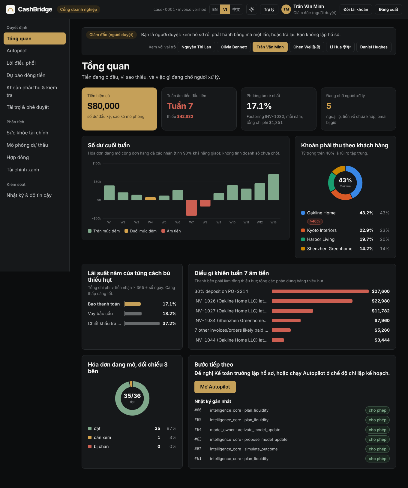
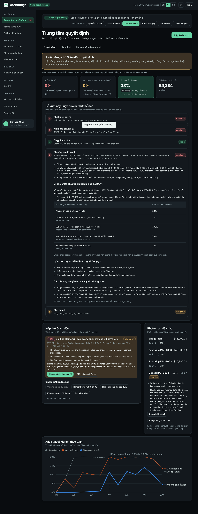
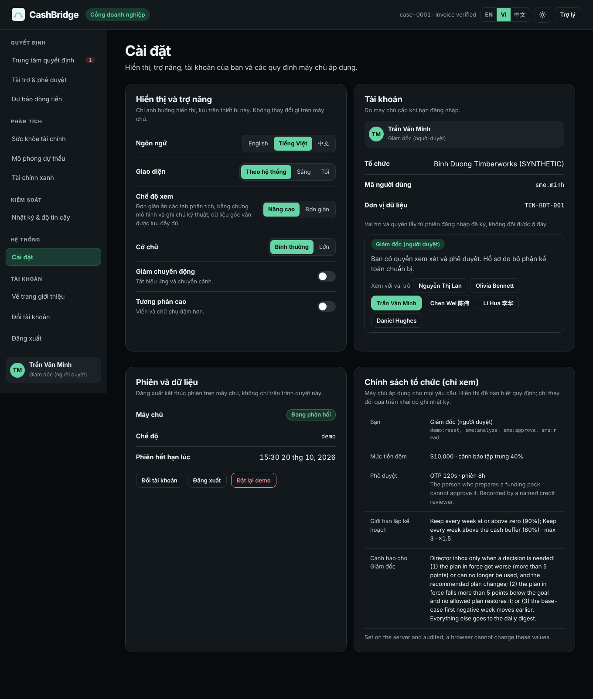
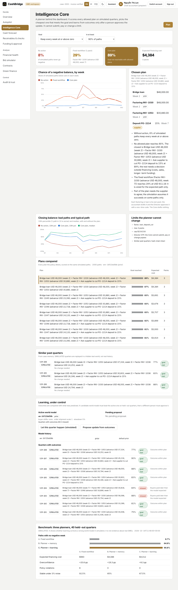
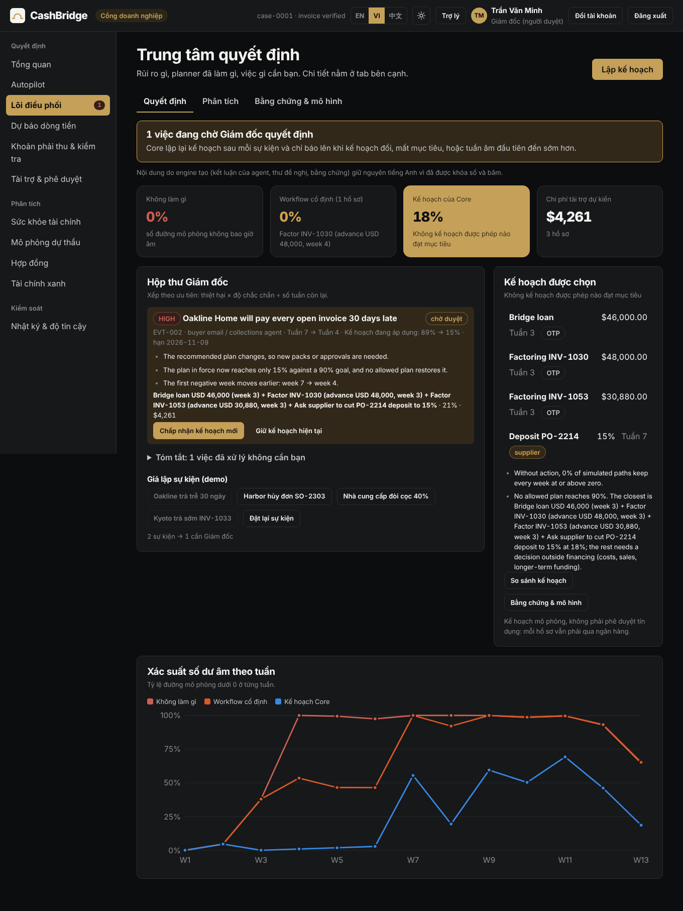
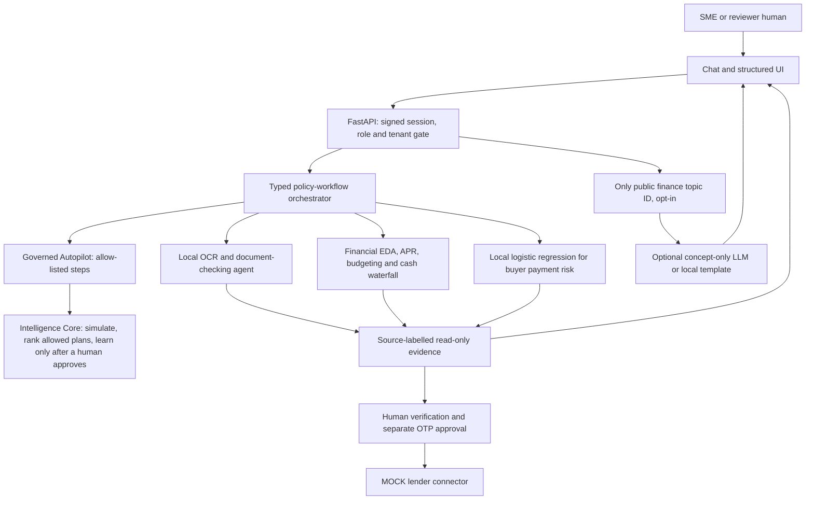

# CashBridge

**AI-powered SME financial decision & financing readiness copilot — from working-capital pressure and marketing budgets to credible green-transition financing preparation.**

Built for the 2026 Shenzhen International FinTech Competition, International Track, Topic E (SME Finance Copilot).
Every company, person, buyer, lender and API in this repository is **SYNTHETIC** or **MOCK**.



## Version 6 (20 Oct 2026): explain every decision, prove what limits it, measure the Director's attention

| What changed | Where | Proof |
|---|---|---|
| **Decision Trace**: five steps rebuilt from the run on screen (risk → evidence → scenarios → recommendation with the two runner-up plans and why they lost → approval) | `ui/web/dist/assets/app.js` (`decisionTrace`) | `docs/screenshots/40-decision-trace-vi-dark.png` |
| **Feasibility certificate**: when no allowed plan reaches the goal, the Core computes the least free cash that would (closed form), the over-borrowing cap, eligible sources, and relaxes one limit at a time on the same scenarios. Diagnostics only: limits never move | `IntelligenceCore.feasibility` | `test_feasibility_certificate_is_a_diagnostic_and_its_cash_bound_is_exact` |
| **CVaR 95%** of the shortfall for every plan, in the trace and the benchmark (reported, not optimised) | `core/scenario_simulator.py` (`summarize`) | `test_cvar_is_the_mean_of_the_worst_five_percent_and_never_below_p95` |
| **Operations benchmark**: 100 synthetic events (finance, reconciliation, invoice audit, refunds, support, overdue, cash alerts) grouped into cases; Director notified **7** times vs 100 (every event) and 19 (amount ≥ USD 10k), 0 decisions missed, 0 side effects | `eval/ops_benchmark.py` → `ops_benchmark.{json,md}` | `make ops`, `tests/test_ops_benchmark.py` |
| **Ablation and calibration** in both benchmarks (see below) | `eval/planner_benchmark.py`, `eval/ops_benchmark.py` | `test_feasibility_ceiling_bounds_every_planner_and_calibration_is_reported` |
| **Settings page** (System › Settings, every role): language, theme, simple/advanced view, text size, reduced motion, high contrast; applied at once and kept on this device. Account block at the bottom of the side bar (home page, switch account, sign out, user card). Organisation policy shown read-only from the server | `app.js` (`routes.settings`), `GET /api/settings/policy` | `test_organisation_policy_is_read_only_and_needs_a_session` |
| **Risk chart**: recommended plan emphasised, baselines muted, direct end labels, peak-risk annotation, tooltip delta, "lower is better"; simple view shows two lines | `assets/charts.js` (`lines`) | `docs/screenshots/41-decision-trace-en-light.png` |
| **Copy quality**: plain Vietnamese and Chinese, SIMULATED pills on simulated numbers, tests for missing keys, placeholders and filler phrases | `assets/i18n.js` | `tests/test_copy_quality.py` |
| **Research basis**: each engine mapped to verified papers, its baseline and the measured result; claims split into implemented / sandbox / roadmap | [`docs/RESEARCH_AND_EVALUATION.md`](docs/RESEARCH_AND_EVALUATION.md) | — |





Why does no planner reach 90% in the benchmark? Free cash equal to the over-borrowing cap from week 1 would reach 90% in **40 of 40**
held-out quarters. The money exists inside the cap; what binds is the plan space (at most 3 packs, factoring and loans repaid
inside 13 weeks, timing). Raising a limit is a policy decision for people, so the Core shows it and stops there.

| Ablation (SIMULATED) | With | Without |
|---|---|---|
| Risk-aware planning (A vs B) | 64.9% of scenarios with no negative week | 8.7% |
| Learning from outcomes (B vs C) | overconfidence +9.3 pp | +19.3 pp |
| Knowing the plan in force when re-planning | same plan after 3% noise 77.5% | 57.5% |
| Plan-in-force check before alerting the Director | 7 notifications, 3 false | 11 notifications, 7 false |
| Grouping events into cases | 7 notifications | 8 |

Calibration: in the planner's own world (fresh scenarios) overconfidence is −1.9 pp, so the Monte Carlo is honest when its
model is right; the gap in the hidden world is model error.

**What is real and what is not.** Implemented and verified: everything in the tables above, with a test or a script. Sandbox:
the factoring partner, the bridge loan, the lender and all outgoing messages are MOCK. Roadmap: a credit model on public data,
a learned forecaster, layout-aware invoice extraction, process mining on the audit log, a cloud worker with retries and a
dead-letter queue.

## Version 2 (19 Oct 2026): two portals, a governed Autopilot, an Intelligence Core, measured trust

**Live flow:** landing page → sign in to the **SME workspace** (Chief accountant prepares, Director approves) or the **Bank review** portal (credit reviewer) → the **Autopilot** goes from cash gap to a drafted funding pack and asks the **Intelligence Core** how often that pack survives bad quarters → the Director releases it with an action-bound OTP → the lender re-verifies every hash and records a human credit decision.

| What changed | Where | Proof |
|---|---|---|
| Server-side sign-in, signed sessions, role permissions, tenant scope; DEMO vs PRODUCTION mode that refuses to start with demo secrets | `security/auth.py`, `config/runtime_mode.py`, `api/main.py` | `tests/test_auth_rbac.py` |
| Segregation of duties: the preparer can never approve, enforced in the permission matrix *and* the coordinator | `agents/coordinator.py` (`approve`) | `SOD-01..03` in the scorecard |
| **Finance Autopilot**: six governed steps, allow-listed transitions, refused planner proposals are logged, every claim tagged `VERIFIED / CALCULATED / MODEL_ESTIMATE / ASSUMPTION / NEEDS_HUMAN / NOT_VERIFIABLE_HERE` | `agents/autopilot.py` | `tests/test_autopilot.py` |
| **Recalibrated synthetic data**: ledger (USD 4.6m revenue, DSO 75), payment history (185 invoices, about USD 4.4m) and the analytics file now agree; the forecast adds **confirmed, not-yet-invoiced orders** at 90% shipment confidence (never pledgeable) | `data/seed_sandbox.py`, `core/forecasting_engine.py` (`ConfirmedOrder`) | `tests/test_intelligence.py`, `tests/test_ui_contract.py` |
| **Coverage check**: does the option keep cash positive after week 7? In the base case yes: the USD 48,000 advance keeps weeks 7-13 at or above zero (lowest USD 5,168 in week 7) | `core/funding_coverage.py` | `test_execute_reaches_director_handoff_with_evidence` |
| **Scenario simulator**: 2,000 simulated quarters per question (invoice-level lateness, buyer slowdowns, order slippage, cost and FX shocks); every plan is scored on the same paths | `core/scenario_simulator.py` | `tests/test_intelligence_core.py` |
| **Intelligence Core**: builds a structured state, enumerates every plan the policy allows (factoring, bridge loan, deposit negotiation; up to 3 packs), picks the cheapest one that reaches the goal probability, and says so when none does. An independent validator refuses orders, unverified or likely-late invoices, over-borrowing and unknown actions | `agents/intelligence_core.py` | `tests/test_intelligence_core.py`, `CORE-01..03` |
| **Learning under control**: case memory (hash-chained), outcome attribution (collections timing, order slippage, cost overrun, funding too small, objective too narrow), a world-model learner gated leave-one-quarter-out, and activation only by a *different* named person | `agents/intelligence_core.py` (`CaseMemory`, `WorldModelLearner`, `ModelRegistry`) | `test_memory_learning_and_gate`, `test_registry_requires_a_different_human_and_an_accepted_gate` |
| **Planner benchmark** (SIMULATED): fixed workflow vs planner + memory vs planner + learning on 40 held-out quarters of a hidden test world | `eval/planner_benchmark.py` → `data/execution_evidence/planner_benchmark.{json,md}` | `make bench`, `tests/test_planner_benchmark.py` |
| **Events and the Director's inbox**: a fixed catalogue of events (buyer pays 30 days late, order cancelled, supplier raises the deposit, early payment) updates a twin of the case; the Core re-plans at once and routes the result to the Director only when a decision is needed (plan changes, the plan in force falls below the goal with no fix, or the first negative week moves earlier); everything else goes to a digest. The Director accepts the new plan or keeps the current one (L2, named) | `agents/intelligence_core.py` (`apply_event`, `assess_event`), `ui/backend_real.py` | `test_events_route_to_digest_or_director_and_never_touch_the_case`, `CORE-04` |
| **Role-based workspaces (v5)**: the Director lands on a *Decision center* (what is at risk, what the planner did, what needs a decision; analysis and model evidence one tab away), the Chief accountant on an Overview with a work queue (exceptions, credits to reconcile, held emails, pack to prepare), the lender on incoming packs. Every refused API call (401/403) is written to the hash-chained audit log with who tried it | `ui/web/dist/assets/app.js`, `api/main.py` (`record_denials`) | `test_refused_calls_are_written_to_the_audit_chain`, `EVID-03` |
| **Every considered plan explained**: each scored plan carries a one-line verdict (why it lost: below goal, dearer, more packs, depends on the supplier) and the page shows how many were scored, refused and reach the goal | `IntelligenceCore._verdict` | `test_plan_in_force_is_kept_within_noise` |
| **Bank portal**: inbox of released packs only, independent hash/chain re-verification, recorded human decision (approve / request info / decline), director reject + accountant rework | `ui/backend_real.py`, `api/main.py` | `tests/test_bank_portal.py` |
| **Trust scorecard**: 25 adversarial security cases, 5 agent scenarios, payment model vs baseline (walk-forward Brier), planner benchmark summary | `eval/trust_scorecard.py` → `data/execution_evidence/trust_scorecard.{json,md}` | `make trust`, `tests/test_trust_scorecard.py` |
| New web UI: landing, two-portal sign-in with one-click demo accounts, SME **Overview dashboard** (KPI cards, weekly balance columns, buyer-concentration donut, funding-cost bars, shortfall drivers, 3-way-match donut), SME and Bank workspaces; **EN / VI / 中文**; light and dark themes in the original graphite-and-gold palette; system fonts, no external requests, CSP `self` | `ui/web/dist/` (`i18n.js`, `charts.js`, `app.js`) | `tests/test_ui_bundle.py` |
| Deploy: Vercel (lean serverless build, `/tmp` runtime, NumPy fallback for the risk model) or Render/Docker | `vercel.json`, `vercel_app.py`, `render.yaml`, `Dockerfile` | [`docs/DEPLOY_VI.md`](docs/DEPLOY_VI.md) |

Demo accounts (DEMO mode only, synthetic, names mixed Vietnamese / English / Chinese): Chief accountants `sme.lan` (Nguyễn Thị Lan) and `sme.olivia` (Olivia Bennett); Directors `sme.minh` (Trần Văn Minh) and `sme.chen` (Chen Wei 陈伟); lender reviewers `bank.lihua` (Li Hua 李华) and `bank.daniel` (Daniel Hughes). Passcode is `<first part after the dot>-demo-2026`, e.g. `lan-demo-2026`. Director OTP secret: `JBSWY3DPEHPK3PXP`.

A review of the project and the roadmap behind these changes (Vietnamese) is in [`docs/REVIEW_VI.md`](docs/REVIEW_VI.md).

### Intelligence Core: plan for bad quarters, learn under control

The Autopilot follows a fixed six-step path. The Intelligence Core sits behind it and answers the next question a credit officer asks: *how often does this plan fail, and what would hold up better?* It never talks to a user and has no tool that submits, pays or changes a limit.

| Layer | Question | Here |
|---|---|---|
| A. Predict | What can happen if we do nothing? | Buyer on-time model (logistic regression) + scenario simulator (2,000 paths) |
| B. Plan | Which allowed plan reaches the goal most cheaply? | Enumerate factoring / loan / deposit plans (max 3 packs), score on the same paths, choose; say "goal not reachable" when true |
| C. Govern | Is that plan allowed? | Independent validator, gatekeeper tiers, audit log; each pack still needs the accountant and the Director's OTP |

Goals are fixed templates (keep every week at or above zero / above the buffer, in 80-95% of paths); free text never selects a goal or a tool. Learning is separate from memory: outcomes are attributed to a cause, a candidate world model must beat the active one on held-out quarters, and a different person activates it.

Planner benchmark (`make bench`, SIMULATED, 40 held-out quarters in a hidden test world where Oakline pays later and orders slip more than stated):

| | A. Fixed workflow | B. Planner + memory | C. Planner + learning |
|---|---|---|---|
| Paths with no negative week (mean) | 8.7% | 64.9% | 66.8% |
| Expected financing cost (mean) | USD 960 | USD 4,086 | USD 4,012 |
| Policy violations | 6 | 0 | 0 |
| Overconfidence (predicted - realised) | +20.6 pp | +19.3 pp | +9.3 pp |
| Shortfall in the worst 5% of scenarios, CVaR 95% (mean) | USD 180,929 | USD 100,057 | USD 98,897 |
| Same plan after 3% input noise (re-plan knowing the plan in force) | 80% | 55% | 77.5% |
| Outcome within 5 points after 3% input noise | 92.5% | 70% | 77.5% |





Read honestly: planning for bad paths is what raises success (A → B), at about four times the financing cost. Learning mainly makes the planner's stated probability truer (B → C); it adds little success because the allowed plans are capped at three packs. Stability is modest: near-equal plans can swap under small input changes; re-planning now keeps the plan in force unless the new one is better by more than simulation noise, which lifted the learning planner from 68% to 78%. Details (Vietnamese): [`docs/INTELLIGENCE_CORE_VI.md`](docs/INTELLIGENCE_CORE_VI.md).

## Privacy-first update: multi-agent workflows with NO LLM orchestration

**The control-plane architecture has been changed after the October evaluation.** The LLM no longer chooses tools, performs extraction, drafts funding letters from private inputs, makes lending decisions or sees SME/Bank documents. A **server-side policy workflow** selects a fixed allowlist of local specialist analytical agents from explicit workflow IDs and validated structured input fields. The original synthetic buyer-risk logistic regression and deterministic cash-flow, APR, invoice and budget engines remain in use. The CFO chat now uses local, constrained read-only explanations. An **optional human-facing concept explainer** accepts only fixed PUBLIC finance topics; it is **off by default** and never receives arbitrary chat text, contracts or case data.

This package also includes `POST /api/copilot/ask` (deterministic multi-step agent trace), `POST /api/projects/waterfall` (strict time-indexed receipt/cost schedules), `POST /api/contracts/draft-docx` (unsigned DOCX draft), and **server-side token authorization** for `GET /api/bank/review`. The packaged zero-build UI supports the policy workflow and bank unlock screen. See [privacy-first architecture, threat model and exact API examples](docs/PRIVACY_FIRST_AGENT_ARCHITECTURE.md).

> All sensitive SME data remains local in this synthetic MVP; this is **not a production security certification**. Since v2 every SME and Bank route requires a signed session with a role and tenant scope (see Version 2 above), but identity is still the built-in demo user store, not an enterprise IdP. Never load real customer information.

## Who it serves — the financial pressure behind every SME decision

SMEs may be profitable yet struggle to cover supplier deposits, payroll and overdue receivables. They must also choose how much they can safely allocate to marketing, equipment, expansion and green upgrades while preserving a liquidity buffer. Financing is difficult to compare, documents take time to prepare, and banks need consistent supporting evidence.

**CashBridge supports better capital decisions before suggesting borrowing:** anticipate liquidity pressure, simulate spending trade-offs, verify receivables, compare financing costs, and assemble a traceable funding pack. A preliminary green-finance pathway helps SMEs organize evidence for investments like solar installations and energy-efficient machinery, while banks retain all lending decisions.

### Application scenarios

| SME challenge | CashBridge workflow | What the current MVP actually supports |
|---|---|---|
| Tight working capital and delayed buyers | Predict cash pressure, examine buyer risk, compare factoring/loans | 13-week forecast, buyer-risk demo and funding APR comparison |
| Uncertain marketing budget during expansion | Protect minimum cash reserve and test marketing-vs-core-spending trade-offs | **Capital Planner** deterministic what-if simulation; not marketing ROI prediction |
| Large upfront green equipment cost | Compare investment outlay with available cash and examine green-project evidence | Capital Planner + **Green Finance** document completeness and illustrative impact |
| Loan documentation burden | Reconcile receivables and prepare traceable documents | Invoice/PO/B-L checks, evidence pack, OTP approval; lender submission is MOCK |
| Bank assessment workload | Present normalized evidence and identify exceptions | Token-gated demo reviewer view (not a production bank identity system or credit approval engine) |

### October 2026 — AI financial & contract intelligence update

Alongside the original 13-week liquidity workflow, this package now includes **working Python endpoints, source-labelled synthetic data, tests, and SME/Bank preview interfaces**:

| Feature | Implemented behavior | Caveat |
|---|---|---|
| Financial Intelligence / EDA | Nine financial ratios, 12-month monthly ledger, z-score expense outliers and funding/marketing scenario | DSCR is a proxy; synthetic historical data; no automatic ROI modeling |
| Project / Bid Risk Simulator | Upfront cash gap, delayed-advance + overrun stress, indicative margin and aggregated workforce gap/cost | Simplified, does not evaluate employees or decide a bid |
| Contract / Invoice Intelligence | Text PDF + local image OCR, USD amount extraction, milestone review, suspicious clause flags, invoice reconciliation | Pattern-based evidence prompts, not fraud proof or legal authenticity |
| Agreement drafting | Supply / service / construction service unsigned templates, validated milestone math, legal-review checklist, TXT export | Draft only; unsigned DOCX export exists; no e-signature or legal authorization |
| Green-investment economics | Synthetic energy saving and simple payback with explicit price / opex assumptions | Not environmental certification or underwriting |
| SME / Bank reviewer views | Two presentation workspaces with shared deterministic engines and human-review checklist | **Bank portal now needs a `bank_reviewer` session (v2); legacy static token still accepted. Identity is the demo user store, not production OIDC** |
| Conversational tools | Offline CFO shortcuts for contract-review summary, marketing impact and finance ratios; original CFO intents retained | Controlled local chat; LLM tool planning is intentionally disabled |

The archive includes an **offline zero-build dashboard** (`ui/web/dist/`) that calls real FastAPI endpoints. The bundled dashboard was exercised in a Chromium browser harness against the in-process FastAPI API, and new screenshots are provided under `docs/screenshots/06–11`. See [implementation notes](docs/INTELLIGENCE_EXTENSION.md) and [3-minute demo story](docs/FINTECHATHON_DEMO_STORY.md).

### What's new in the earlier green/capital extension

- **Capital Planner** tab: editable cash, reserve, working capital, marketing and green-investment budgets; server-side cash-gap simulation and marketing-deferral what-if. It does **not** forecast campaign revenue, optimize ROI or calculate a recommended loan size.
- **Green Finance** tab: synthetic rooftop-solar and efficient-machinery projects, evidence checklist, non-certified environmental impact estimates, SME/bank-view toggle, and a demo-only human-review request.
- **Bank-ready narrative**: evidence-backed readiness rather than claims of approved green credit, taxonomy certification or direct disbursement.

### Product architecture boundary

API connectors are integration infrastructure, not ML models. Deterministic engines handle money, constraints, matching and approvals; the fitted local buyer-payment model assists forecasting, while statistical outlier flags are not proof of fraud. A policy engine dispatches all specialist finance workflows. The optional LLM only explains predefined PUBLIC topics when separately enabled; it cannot receive case data or invoke tools. Human approval gates sensitive actions. **Live ERP/bank APIs, full ML anomaly models, marketing ROI modeling, production OIDC and tenant-scoped bank access, official green taxonomy rules and post-loan monitoring remain roadmap items.**

## The problem

Vietnamese B2B export manufacturers sell on 45 to 90 day open-account terms to buyers in the US, Japan and China. On paper they are profitable, yet they run out of cash, because working capital is locked in unpaid invoices and supplier deposits (`CCC = DIO + DSO − DPO`). Banks cannot verify foreign invoices or stop the same invoice being financed twice, so they ask for real-estate collateral.

| Fact | Source |
|---|---|
| About 8.8% of Vietnamese SMEs access bank loans, against 47.1% of large firms | FiinGroup, "Vietnam SME: Maturity and Credit Access", Aug 2026 |
| International factoring is about 0.04% of Vietnam's trade turnover, against 0.86% in developing economies | VNBA / IFC / FCI workshop, Mar 2026 |
| Factoring outstanding is about VND 22,000 bn across 16 credit institutions | VNBA, Mar 2026 |
| WeBank launched 微贸贷 (an online credit loan for small foreign-trade firms) with China Eximbank Shenzhen, Sinosure Shenzhen and Shenzhen Southern E-Port | Xinhua, 27 May 2025 |
| US tariffs on Vietnamese goods changed several times in 2025 to 2026 | Described as volatility only; no current rate is quoted |

## How it works

CashBridge follows one loop. Each step is a section of the dashboard.

1. **Anticipate.** A 13-week cash forecast finds the first week the account goes negative and says what causes it.
2. **Prove.** Bank credits are matched to invoices (including one wire that pays several invoices at once). Each invoice is checked against its purchase order and bill of lading, and suspicious emails are blocked.
3. **Compare.** Every way to bridge the gap is priced by what it really costs per year.
4. **Approve.** The numbers are locked into a funding pack, and the Director approves it with a one-time code that works for that exact pack only.

> **AI reads and writes. Code calculates and decides. Humans approve everything that leaves the system.**
> No language model ever does arithmetic, matching or eligibility. Every number comes from tested Python, and any text a model writes is rejected unless every number in it is one of the locked figures.

### The demo company

Binh Duong Timberworks Co., Ltd. (SYNTHETIC) has about 120 staff and annual revenue of about VND 120 bn. Demo exchange rates are fixed and labelled as assumed: USD/VND 26,000, JPY/VND 175, CNY/VND 3,650.

| What happens | Result in the demo |
|---|---|
| Cash conversion cycle | 82 days (35 stock + 75 collection − 28 payment), computed from the ledger |
| A USD 48,620 wire arrives | Matched to INV-1021 + INV-1022 + INV-1024; the USD 35 gap is booked as a bank fee |
| First negative week | Week 7, short by about USD 42,800 (a 30% timber deposit, month-end payroll and late US invoices) |
| With the USD 48,000 advance | Every week from 7 to 13 stays at or above zero in the base case |
| On 2,000 simulated quarters | The single advance keeps cash at or above zero about 28% of the time; the Intelligence Core's plan (bridge loan + factoring INV-1030 + INV-1053, drawn in week 2) about 87%, 89% if the supplier also accepts a lower deposit: still short of the 90% goal, and it says so |
| What it costs to bridge | Factoring INV-1030 about 17.1% a year, a bridge loan about 18.2%, an early-payment discount (2/10 net 30) about 37.2%; no overdraft on file |
| Invoice checks | INV-1030 is eligible; INV-1027 is flagged (two packages missing) |
| A lookalike-domain email asks to change bank details | Blocked |

The lender is "Partner Factor (FCI two-factor model, MOCK)". WeBank appears only as the intended white-label channel; no WeBank API is claimed.

### Capital planning and green financing APIs

- `POST /api/capital-plan` accepts five non-negative USD fields: `available_cash_usd`, `minimum_reserve_usd`, `working_capital_usd`, `marketing_usd`, and `green_investment_usd`. It returns deployable cash after reserve, immediate funding gap and a marketing-deferral scenario. Assumes immediate outlays; no future receipts, loan repayments, interest or marketing ROI.
- `GET /api/green-finance` returns **synthetic** environmental-document pre-screening results.
- `POST /api/green-finance/request-review` with `{"project_id":"..."}` adds a demo-only pending review state; no external bank is contacted.

Neither capital planning nor green screening authorizes spending, certifies sustainable activities, or makes a credit decision.

## Quickstart

You need Python 3.11 or newer and the Python dependencies in `requirements.txt`. The archive **includes a working no-build offline dashboard** served automatically by FastAPI. No Node or npm is needed: the web app has no build step. For OCR of scanned pages/photos, install the **Tesseract OCR executable** locally; Docker installs it for you.

```bash
python3 -m venv .venv
.venv/bin/pip install -r requirements-dev.txt   # runtime + PDF/OCR + scikit-learn + pytest
cp .env.example .env        # optional
make test                   # all tests, no network, no API key
make trust                  # security + agent + model scorecard
make run                    # landing page, both portals and the API at http://localhost:8000
```

| Command | What it does |
|---|---|
| `make seed` | Writes the deterministic SYNTHETIC inputs to `data/sandbox_inputs/` |
| `make test` | Runs the test suite (about 2 minutes) |
| `make test-fast` | Everything except the slow end-to-end scorecard run (about 1 minute) |
| `make run` | Serves the dashboard and API on port 8000 |
| `make story` | Runs the 11-step demo story headless and regenerates `data/execution_evidence/` |
| `make eval` | Runs 20 evaluation tasks and writes `data/execution_evidence/eval_report.md`; with an API key it also scores an LLM-only baseline |
| `make anchor` | Appends the audit-log and registry head hashes to `data/execution_evidence/ANCHORS.md` |
| `make trust` | Runs the trust scorecard (adversarial security cases, Autopilot scenarios, payment-model backtest, planner benchmark summary) |
| `make bench` | Runs the planner benchmark (about 1 minute, SIMULATED) and writes `data/execution_evidence/planner_benchmark.md` |

### Fully local financial operations; optional public-only LLM

The forecast, EDA, contract/OCR processing, document matching, local buyer-risk model and policy workflows **remain local even when `LLM_API_KEY` is set**. The dashboard badge shows `local-finance-engines`.

An optional *human-facing concept explainer* can provide generic explanations of a predefined public topic; it never accepts a free-form user prompt or financial documents. It is **off by default**. To enable generic model-generated explanations after provider review, configure:

```env
CASHBRIDGE_CONCEPT_LLM_ENABLED=true
LLM_BASE_URL=https://api.openai.com/v1
LLM_MODEL=your-model
LLM_API_KEY=your-key
```

When disabled or on provider failure, the explainer returns a local template. No raw SME data is transmitted by this endpoint. **Do not enable the optional provider without reviewing the receiving model's data practices.**

### Accounts, sessions and production mode

Demo accounts are built in and only exist in `DEMO` mode (the default). To run with real accounts set `CASHBRIDGE_ENV=production`; the server then **refuses to start** unless all of these are set:

```env
CASHBRIDGE_ENV=production
OTP_SECRET=<your own Base32 secret, not the public demo one>
CASHBRIDGE_SESSION_SECRET=<random, 32+ characters>
CASHBRIDGE_USERS_JSON=[{"user_id":"...","name":"...","role":"sme_accountant|sme_director|bank_reviewer","org":"...","tenant_id":"...","passcode_hash":"..."}]
```

Create a hash with `python scripts/hash_passcode.py`. In production the demo-login, reset, tamper and public-overview routes return 404. The legacy `CASHBRIDGE_BANK_REVIEW_TOKEN` still works for the old `/api/bank/review` endpoint. Deployment steps (Vercel, Render, Docker): [`docs/DEPLOY_VI.md`](docs/DEPLOY_VI.md).

### Approving as the Director

Submitting a funding pack is a level 3 action and needs a 6-digit one-time code. The demo secret is public:

```
OTP_SECRET=JBSWY3DPEHPK3PXP
```

Add it to any authenticator app (choose manual entry, Base32, 30-second codes). A code works once, only for the pack on screen, and only within 120 seconds.

## Using the web app

Open http://localhost:8000. Language (EN / VI / 中文) and light/dark theme switches sit in the top bar. The landing page shows the live 13-week forecast (synthetic) with the recommended advance drawn on it. **Sign in** opens a dialog with two sides, **SME workspace** and **Bank review**, each with one-click demo accounts.

The 3-minute demo:

1. Sign in as **Nguyễn Thị Lan (Chief accountant)** → *Autopilot* → **Run and draft the pack**. Read the trace, the recommendation, the honest "what this does not fix" box and the evidence register.
2. **Switch account** (or the *View as* buttons on the Overview) → **Chen Wei 陈伟 or Trần Văn Minh (Director)** → *Funding & approval* (badge shows 1 waiting) → **Approve with one-time code** (authenticator secret `JBSWY3DPEHPK3PXP`). Try **Reject** instead to see the rework loop.
3. **Switch account** → Bank side → **Li Hua 李华 (credit reviewer)** → *Incoming packs* → open the pack → **Run verification** → record a decision.
4. Back in the SME workspace, *Funding & approval* shows the lender's decision; *Audit & trust* shows the audit chain, registry and the trust scorecard.
5. Optional, 2 minutes: *Intelligence Core* → **Plan**. Under *Events*, click **Kyoto pays INV-1033 early** (goes to the digest: nothing to decide) and **Oakline pays 30 days late** (goes to the Director's inbox with its reasons); switch to the Director, who sees a badge on *Intelligence Core* and accepts or keeps the plan. Then compare the single pack (about 28% of simulated quarters stay at or above zero) with the Core's plan (about 87%). As the accountant, **Let this quarter happen (simulated)** and **Propose update from outcomes**; as the Director, **Approve update**, then plan again: the planner now uses the learned world model and is less optimistic.

| SME section | What you do there |
|---|---|
| Overview | Dashboard: cash today, first negative week, cheapest cover, items waiting for a person; charts; *View as* buttons to switch persona in one click |
| Autopilot | Governed agent run: plan-only (Director) or draft the pack (Accountant); trace, recommendation, coverage chart, scenario test, evidence register |
| Intelligence Core | Risk by week on simulated quarters, every allowed plan ranked with a verdict, the chosen plan and why, events and the Director's inbox, similar past quarters, learning status (propose / approve a world-model update), the planner benchmark |
| Cash forecast | 13-week chart, scenario sliders, shortfall attribution, buyer payment risk |
| Receivables & checks | Wire reconciliation, 3-way match, scanned-document confidence, held emails |
| Funding & approval | Options priced as annual cost, pack, cover letter, PDF, OTP approval / reject, lender status, safeguard demos |
| Financial health, Bid simulator, Contracts, Green finance | The October intelligence tools |
| Audit & trust | Scorecard, audit chain verify + tamper demo, registry, privacy masking preview, demo reset |

| Bank section | What you do there |
|---|---|
| Incoming packs | Only packs the Director released |
| Case | Locked metrics, letter, pledged invoice and scans, SME forecast, the agent's evidence (unverifiable items first), hash re-verification, decision |
| Audit & trust | The public trust scorecard |

The **Assistant** button (SME) opens the CFO chat; every answer lists where its numbers come from.

### API

The dashboard uses `/api/...`. The October intelligence APIs are documented in [`docs/INTELLIGENCE_EXTENSION.md`](docs/INTELLIGENCE_EXTENSION.md): financial summary/scenario, project assess, contract draft/analyze/reconcile/upload and green payback, plus bank reviewer preview. For integrations, the same engines are exposed as `GET /forecast` (optionally with `dso_change_days`, `deposit_pct`, `tariff_shared_pct`, `fx_change_pct`), `GET /reconcile`, `GET /funding-options`, `POST /packs`, `POST /packs/{id}/request-approval`, `POST /packs/{id}/approve` and `GET /audit/verify`. Interactive documentation is at http://localhost:8000/docs. Approving a pack still needs the one-time code and the coordinator permission gate. The new internal-only analysis and unsigned-drafting calls are separately **hash-audit-logged** and have no external action path; all case routes require a signed session (SME roles or `bank_reviewer`); full multi-tenant identity management and an enterprise IdP remain out of scope.

## Architecture



The dashboard never calculates authoritative financial results. It renders backend calculations. The original workflow contract is in `docs/UI_CONTRACT.md` and intelligence APIs are in `docs/INTELLIGENCE_EXTENSION.md`.

### Five permission tiers

| Tier | Scope | Approval |
|---|---|---|
| L0 Read | Bank statements, e-invoices, bills of lading, POs, inbox | Automatic |
| L1 Analyze | Forecasts, APR comparisons, risk scores, drafts | Automatic |
| L2 Internal write | Ledger entries for exact and subset-sum matches; period locking | Automatic at confidence 1.0; fuzzy matches need the accountant |
| L3 External | Submitting a funding pack, sending any external email | A one-time code from the Director for every single action |
| L4 Money movement | Payments, changing payee details | Always blocked in code; do it in your banking portal |

### Security and evidence

- **Tamper-evident audit log.** One hash-chained line per permission decision; `verify_chain` reports the first broken line.
- **Anti-double-financing registry.** Keyed on the invoice's content (not the PDF file), so re-scanning a document cannot create a second entry.
- **Prompt-injection guard.** Emails and documents are data, never instructions.
- **Business-email-compromise detection.** Lookalike domains, bank-detail change requests and unverified accounts are blocked, and payee details are never updated automatically.
- **Number lock.** Model-written text is rejected if it contains any number that is not a locked figure.
- **Verifiable Funding Pack.** A PDF with the cover letter, locked metrics, a 3-way match summary, the SHA-256 of every source document and of the whole bundle, the registry reference and an appendix of formulas, so a lender can recompute the figures.
- **Document reading with confidence.** Scanned documents are read field by field; anything below 0.85 confidence is left for a person instead of guessed.
- **Buyer risk model.** The chance each invoice is paid on time comes from a logistic regression fitted on the company's own payment history, with its coefficients shown. A buyer holding more than 40% of open invoices is flagged as a concentration risk.
- **Collections ladder.** Reminders 3 days before the due date, on it, and 7, 15 and 30 days after, drafted in English, Japanese or Chinese by buyer market. Nothing is sent without the Director's one-time code.

## Repository layout

```text
config/     settings.py, tool_allowlist.py (which agent may use which tool), runtime_mode.py (DEMO vs PRODUCTION)
schemas/    Pydantic v2 data contracts
core/       matching, forecasting, scenario_simulator, funding evaluator, invoice registry, period lock, pack metrics, PDF compiler
            (pure Python: no LLM)
security/   auth.py (sessions, roles, tenants), permission gatekeeper, audit log, OTP, PII masker, injection guard, number check, BEC detector
agents/     autopilot, intelligence_core (planner, memory, learner, registry), coordinator, CFO assistant, document agent, collections agent, buyer risk agent (NumPy fallback), LLM client
api/        FastAPI app and the MOCK lender connector
ui/         backend_real.py; web/dist/ (the live no-build UI: landing, SME and Bank apps, EN/VI/ZH, light/dark)
data/       seed_sandbox.py, loader.py, sandbox_inputs/, execution_evidence/
scripts/    run_demo_story.py, anchor_head.py, export_ui_snapshot.py
eval/       tasks.yaml, run_eval.py, trust_scorecard.py (security cases, agent scenarios, model backtest), planner_benchmark.py
docs/       REVIEW_VI.md, INTELLIGENCE_CORE_VI.md, DEPLOY_VI.md, UI_CONTRACT.md, screenshots/
contracts/ OCR extraction, unsigned draft templates, contract and invoice rule-based review
tests/      pytest suite (original + intelligence extension tests)
```

## Limits

- The registry and audit chain are **tamper-evident**, not tamper-resistant. Someone with write access could rewrite both files; anchoring the head hashes in git is the mitigation.
- A registry inside one company's installation cannot stop the same invoice being financed at a second lender. In production it must be shared, for example run by a lender consortium or anchored to the e-invoice authority.
- The demo one-time-code secret and demo passcodes are public by design; PRODUCTION mode refuses to start with them.
- **The Intelligence Core's world model is ours.** Slowdown probability, order slippage and cost noise are stated priors; the "hidden test world" that produces simulated outcomes and the benchmark is also written by us. The benchmark shows that learning corrects a mis-specified model *in simulation* (overconfidence about 19 → 9 points); it is not evidence about real SMEs. Nothing learns from real transactions, and a model update needs an offline gate plus a second person.
- On Vercel the runtime is `/tmp` and instances may run in parallel, so a pack prepared on one instance may not appear on another. Use Render/Docker for judging. The lean Vercel build has no PDF/image OCR (paste text or upload TXT).
- All data, lenders and bank connections are synthetic or mocked.

## Out of scope

Automated marketing execution/ROI forecasting, legally binding contracts and qualified legal review, individual employee scoring, official green taxonomy certification, authentic bank role management, KYC approval, cross-lender duplicate-financing verification, production underwriting, real ERP/bank/e-invoice APIs and full-scale project scheduling. **Basic contract/bid financial review and budget/green what-if are implemented as synthetic MVP features**, not deployed products.

Demo video: _link to be added_

## Project documents

- `docs/PRIVACY_FIRST_AGENT_ARCHITECTURE.md`: current policy workflow, data boundaries and threat model.
- `buildplan.md`: the phased build plan and progress tracker.
- `DECISIONS.md`: design choices, with a table mapping each security control to its file and test.
- `docs/UI_CONTRACT.md`: the interface between the dashboard and the backend.
- `docs/RESEARCH_AND_EVALUATION.md`: research basis, baselines, measured results, ablation, claim tiers and references.

## Green Finance extension (synthetic MVP)

The source includes a **Green Finance** tab with SME/bank reviewer views, environmental evidence checklist, indicative impact calculations and a demo-only human review request. See [`docs/GREEN_FINANCE_MVP.md`](docs/GREEN_FINANCE_MVP.md). This is **not** bank approval, green taxonomy certification, live API ingestion or verified emissions monitoring.

**No Node build is required, and there is no build step at all.** The web app is the hand-written static files in `ui/web/dist/` (HTML, CSS, JS), served by FastAPI exactly as committed. The old React/Vite prototype was removed in v5: its `npm run build` would have overwritten this folder with a different interface.

## FinTechathon analytics refinement (2026-10-19)
The Financial Intelligence Lab now includes source-labelled DSO/DIO estimates, operating margin, receivables exposure, inventory intensity and net working capital. DPO and cash-conversion cycle remain explicitly unavailable when trade-payables evidence is missing; no proxy is silently substituted.

Modules integrated in this package: SME finance EDA and cash simulations, project/bid feasibility and aggregate workforce capacity, contract text/PDF extraction, rule-based clause/amount anomalies and human-reviewed unsigned contract drafting, green financing economics, and demo Bank Review. **This is a synthetic demonstration, not production banking software or verified fraud detection.**

Tests: `python -m pytest -q` (including privacy and adversarial suites). The v2 frontend in `ui/web/dist` is hand-written static files (no build step).

## Back-office automation extension (October 2026)

An opt-in `automation/` deterministic worker supports reconciliation, audit exception highlights, draft customer replies, refund **review**, employee task proposals, reminders, cash alerts, and aggregated executive digests. New numeric provenance highlights separately mark edited values and AI/ML/calculated figures, always with source/provenance fields and a human-review state. Auditors can SHA-256-seal reviewed evidence. **No autonomous refunds, outbound emails, calendar writes, accounting postings, or production cloud scheduling are implemented.** See `docs/AUTOMATION_CLOUD_AUDIT_GUIDE.md` for exact API/job examples and security boundaries.
