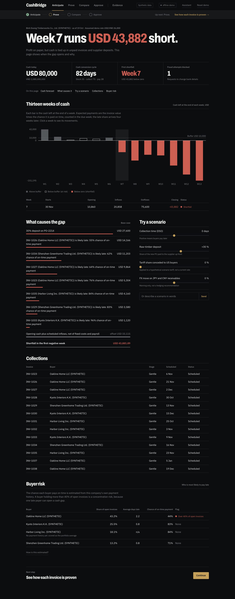
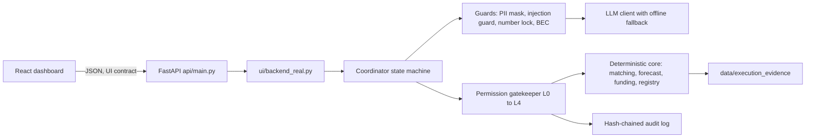

# CashBridge

**An SME finance copilot for export manufacturers. It turns each export invoice into evidence a lender can verify, and then into cash.**

Built for the 2026 Shenzhen International FinTech Competition, International Track, Topic E (SME Finance Copilot).
Every company, person, buyer, lender and API in this repository is **SYNTHETIC** or **MOCK**.



## The problem

Vietnamese B2B export manufacturers sell on 45 to 90 day open-account terms to buyers in the US, Japan and China. On paper they are profitable, yet they run out of cash, because working capital is locked in unpaid invoices and supplier deposits (`CCC = DIO + DSO − DPO`). Banks cannot verify foreign invoices or stop the same invoice being financed twice, so they ask for real-estate collateral.

| Fact | Source |
|---|---|
| About 8.8% of Vietnamese SMEs access bank loans, against 47.1% of large firms | FiinGroup, "Vietnam SME: Maturity and Credit Access", Aug 2026 |
| International factoring is about 0.04% of Vietnam's trade turnover, against 0.86% in developing economies | VNBA / IFC / FCI workshop, Mar 2026 |
| Factoring outstanding is about VND 22,000 bn across 16 credit institutions | VNBA, Mar 2026 |
| WeBank launched 微贸贷 (an online credit loan for small foreign-trade firms) with China Eximbank Shenzhen, Sinosure Shenzhen and Shenzhen Southern E-Port | Xinhua, 27 May 2025 |
| US tariffs on Vietnamese goods changed several times in 2025 to 2026 | Described as volatility only; no current rate is quoted |

## How it works

CashBridge follows one loop. Each step is a section of the dashboard.

1. **Anticipate.** A 13-week cash forecast finds the first week the account goes negative and says what causes it.
2. **Prove.** Bank credits are matched to invoices (including one wire that pays several invoices at once). Each invoice is checked against its purchase order and bill of lading, and suspicious emails are blocked.
3. **Compare.** Every way to bridge the gap is priced by what it really costs per year.
4. **Approve.** The numbers are locked into a funding pack, and the Director approves it with a one-time code that works for that exact pack only.

> **AI reads and writes. Code calculates and decides. Humans approve everything that leaves the system.**
> No language model ever does arithmetic, matching or eligibility. Every number comes from tested Python, and any text a model writes is rejected unless every number in it is one of the locked figures.

### The demo company

Binh Duong Timberworks Co., Ltd. (SYNTHETIC) has about 120 staff and annual revenue of about VND 120 bn. Demo exchange rates are fixed and labelled as assumed: USD/VND 26,000, JPY/VND 175, CNY/VND 3,650.

| What happens | Result in the demo |
|---|---|
| Cash conversion cycle | 82 days (35 stock + 75 collection − 28 payment), computed from the ledger |
| A USD 48,620 wire arrives | Matched to INV-1021 + INV-1022 + INV-1024; the USD 35 gap is booked as a bank fee |
| First negative week | Week 7, short by about USD 42,000 (a 30% timber deposit and a late US invoice) |
| What it costs to bridge | Factoring INV-1030 about 17.1% a year, a bridge loan about 18.2%, an early-payment discount (2/10 net 30) about 37.2%; no overdraft on file |
| Invoice checks | INV-1030 is eligible; INV-1027 is flagged (two packages missing) |
| A lookalike-domain email asks to change bank details | Blocked |

The lender is "Partner Factor (FCI two-factor model, MOCK)". WeBank appears only as the intended white-label channel; no WeBank API is claimed.

## Quickstart

You need Python 3.11 or newer. Node is only needed to rebuild the UI; the built dashboard is included.

```bash
python3 -m venv .venv
.venv/bin/pip install -r requirements.txt
cp .env.example .env        # optional
make test                   # all tests, no network, no API key
make run                    # dashboard and API at http://localhost:8000
```

| Command | What it does |
|---|---|
| `make seed` | Writes the deterministic SYNTHETIC inputs to `data/sandbox_inputs/` |
| `make test` | Runs the test suite |
| `make run` | Serves the dashboard and API on port 8000 |
| `make story` | Runs the 11-step demo story headless and regenerates `data/execution_evidence/` |
| `make eval` | Runs 20 evaluation tasks and writes `data/execution_evidence/eval_report.md`; with an API key it also scores an LLM-only baseline |
| `make anchor` | Appends the audit-log and registry head hashes to `data/execution_evidence/ANCHORS.md` |
| `make ui` | Rebuilds the React bundle in `ui/web/dist` (needs Node 20 or newer) |

### Offline by default

With no `LLM_API_KEY` the whole product runs without a network connection, using fixed templates and rule-based parsing. The header badge reads `offline-demo`. To use a live model, set these in `.env` (any OpenAI-compatible provider works, so DeepSeek or Qwen can be used in mainland China):

```
LLM_BASE_URL=https://api.openai.com/v1
LLM_MODEL=your-model
LLM_API_KEY=your-key
```

If a call fails or takes longer than 8 seconds, the app drops back to offline mode. Text is PII-masked before it reaches a model.

### Approving as the Director

Submitting a funding pack is a level 3 action and needs a 6-digit one-time code. The demo secret is public:

```
OTP_SECRET=JBSWY3DPEHPK3PXP
```

Add it to any authenticator app (choose manual entry, Base32, 30-second codes). A code works once, only for the pack on screen, and only within 120 seconds.

## Using the dashboard

Open http://localhost:8000. The top bar holds the five sections (keys 1 to 5 also switch), and a progress strip underneath shows where you are and what to do next.

| Section | What you do there |
|---|---|
| Anticipate | Read the 13-week chart, see what causes the gap, move the sliders to try scenarios, and see which buyers are most likely to pay late |
| Prove | Check the reconciliation, the wire explanation, blocked emails, what the document agent read from scanned documents, and invoice checks |
| Compare | Choose a funding option |
| Approve | Prepare the pack, download the PDF funding pack, enter the code, and try the two safeguard demos (financing the same invoice twice, tampering with the draft) |
| Evidence | Verify the audit chain, run the tamper demo on a temporary copy, see the invoice registry and the evaluation results |

The **Assistant** button opens a drawer with the CFO chat (ask about the shortfall, the cheapest funding, the cash conversion cycle, a slower-collections, tariff or FX scenario, or which buyer is most at risk; every answer lists where its numbers come from), a log of every permission decision, and a privacy check showing masked text. **Reset demo** starts a fresh session.

### API

The dashboard uses `/api/...`. For integrations, the same engines are exposed as `GET /forecast` (optionally with `dso_change_days`, `deposit_pct`, `tariff_shared_pct`, `fx_change_pct`), `GET /reconcile`, `GET /funding-options`, `POST /packs`, `POST /packs/{id}/request-approval`, `POST /packs/{id}/approve` and `GET /audit/verify`. Interactive documentation is at http://localhost:8000/docs. Approving a pack still needs the one-time code, and every call goes through the same permission checks.

## Architecture



The dashboard never calculates a money value. It renders what the backend returns through the contract in `docs/UI_CONTRACT.md`.

### Five permission tiers

| Tier | Scope | Approval |
|---|---|---|
| L0 Read | Bank statements, e-invoices, bills of lading, POs, inbox | Automatic |
| L1 Analyze | Forecasts, APR comparisons, risk scores, drafts | Automatic |
| L2 Internal write | Ledger entries for exact and subset-sum matches; period locking | Automatic at confidence 1.0; fuzzy matches need the accountant |
| L3 External | Submitting a funding pack, sending any external email | A one-time code from the Director for every single action |
| L4 Money movement | Payments, changing payee details | Always blocked in code; do it in your banking portal |

### Security and evidence

- **Tamper-evident audit log.** One hash-chained line per permission decision; `verify_chain` reports the first broken line.
- **Anti-double-financing registry.** Keyed on the invoice's content (not the PDF file), so re-scanning a document cannot create a second entry.
- **Prompt-injection guard.** Emails and documents are data, never instructions.
- **Business-email-compromise detection.** Lookalike domains, bank-detail change requests and unverified accounts are blocked, and payee details are never updated automatically.
- **Number lock.** Model-written text is rejected if it contains any number that is not a locked figure.
- **Verifiable Funding Pack.** A PDF with the cover letter, locked metrics, a 3-way match summary, the SHA-256 of every source document and of the whole bundle, the registry reference and an appendix of formulas, so a lender can recompute the figures.
- **Document reading with confidence.** Scanned documents are read field by field; anything below 0.85 confidence is left for a person instead of guessed.
- **Buyer risk model.** The chance each invoice is paid on time comes from a logistic regression fitted on the company's own payment history, with its coefficients shown. A buyer holding more than 40% of open invoices is flagged as a concentration risk.
- **Collections ladder.** Reminders 3 days before the due date, on it, and 7, 15 and 30 days after, drafted in English, Japanese or Chinese by buyer market. Nothing is sent without the Director's one-time code.

## Repository layout

```text
config/     settings.py (constants), tool_allowlist.py (which agent may use which tool)
schemas/    Pydantic v2 data contracts
core/       matching, forecasting, funding evaluator, invoice registry, period lock, pack metrics, PDF compiler
            (pure Python: no LLM)
security/   permission gatekeeper, audit log, OTP, PII masker, injection guard, number check, BEC detector
agents/     LLM client, coordinator, CFO assistant, document agent, collections agent, buyer risk agent
api/        FastAPI app and the MOCK lender connector
ui/         backend_real.py (the UI contract on the real engines) and web/ (React + TypeScript)
data/       seed_sandbox.py, loader.py, sandbox_inputs/, execution_evidence/
scripts/    run_demo_story.py, anchor_head.py, export_ui_snapshot.py
eval/       tasks.yaml and run_eval.py (CashBridge against an LLM-only baseline)
docs/       UI_CONTRACT.md, screenshots/
tests/      pytest suite
```

## Limits

- The registry and audit chain are **tamper-evident**, not tamper-resistant. Someone with write access could rewrite both files; anchoring the head hashes in git is the mitigation.
- A registry inside one company's installation cannot stop the same invoice being financed at a second lender. In production it must be shared, for example run by a lender consortium or anchored to the e-invoice authority.
- The demo one-time-code secret is public by design.
- All data, lenders and bank connections are synthetic or mocked.

## Out of scope

Marketing agent, contract and bid evaluation agent, ESG / CBAM add-on, inventory, payroll and tax agents, real bank Open API and e-invoice connectors, a shared cross-lender registry, and expansion to distributors, forwarders and household businesses.

Demo video: _link to be added_

## Project documents

- `instructions.md`: the build specification.
- `buildplan.md`: the phased build plan and progress tracker.
- `DECISIONS.md`: design choices, with a table mapping each security control to its file and test.
- `docs/UI_CONTRACT.md`: the interface between the dashboard and the backend.
