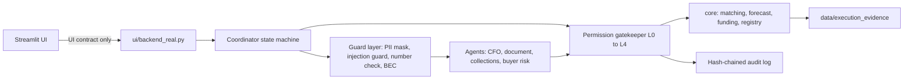

# CashBridge: SME Finance Copilot for Export Enterprises

> CashBridge turns each export invoice into evidence a lender can verify, and then into cash.

**Status: in progress.** The deterministic core, the security layer and the seed data are built and tested (Phases 0 to 2 and Steps 3.1 to 3.3). The coordinator, agents, API and dashboard are not built yet. See [Built / Not built](#built--not-built).

2026 Shenzhen International FinTech Competition, International Track, Topic E: SME Finance Copilot.
All companies, people, buyers, lenders and APIs in this repository are **SYNTHETIC** or **MOCK**.

## The problem

Vietnamese B2B export manufacturers sell on 45 to 90 day open-account terms to buyers in the US, Japan and China. They look profitable on paper but run out of cash because working capital is locked in receivables and supplier deposits (`CCC = DIO + DSO - DPO`). Banks cannot verify foreign invoices or prevent double-financing, so they ask for real-estate collateral.

| Fact | Source |
|---|---|
| About 8.8% of Vietnamese SMEs access bank loans, against 47.1% of large firms | FiinGroup, "Vietnam SME: Maturity and Credit Access", Aug 2026 |
| International factoring is about 0.04% of Vietnam's trade turnover, against 0.86% in developing economies | VNBA / IFC / FCI workshop, Mar 2026 |
| Factoring outstanding is about VND 22,000 bn across 16 credit institutions | VNBA, Mar 2026 |
| WeBank launched 微贸贷 (an online credit loan for small foreign-trade firms) with China Eximbank Shenzhen, Sinosure Shenzhen and Shenzhen Southern E-Port | Xinhua, 27 May 2025 |
| US tariffs on Vietnamese goods changed several times in 2025 to 2026 | Described as volatility only; no current rate is quoted |

## The core loop

1. **Anticipate**: 13-week cash forecast with the first shortfall week and its drivers.
2. **Prove**: reconcile payments, 3-way match PO, invoice and bill of lading, and package the evidence.
3. **Compare and Choose**: a liquidity menu ranked by annualised cost.
4. **Approve**: OTP-gated, human-in-the-loop.

Design rule: *AI reads and writes. Code calculates and decides. Humans approve everything that leaves the system.*

## Quickstart

```bash
python3 -m venv .venv
.venv/bin/pip install -r requirements.txt
cp .env.example .env        # optional; leave LLM_API_KEY empty to run offline
make seed                   # writes SYNTHETIC inputs to data/sandbox_inputs/
make test                   # 188 tests, no network, no API key
```

`make story`, `make eval`, `make run` and `make anchor` are defined but their scripts arrive in later phases (see below).

## Demo scenario (single source of truth: `instructions.md` section 2)

Company: Binh Duong Timberworks Co., Ltd. (SYNTHETIC), about 120 staff, annual revenue about VND 120 bn.
Fixed demo FX rates (assumed): USD/VND 26,000, JPY/VND 175, CNY/VND 3,650.

| Item | Target |
|---|---|
| Cash conversion cycle | 82 days (DIO 35 + DSO 75 - DPO 28), computed from the ledger |
| Incoming wire | +USD 48,620, matched by subset-sum to INV-1021 + INV-1022 + INV-1024 (gap USD 35, booked as a bank fee) |
| First negative week | Week 7, shortfall between USD 40,000 and 47,000 |
| Liquidity menu | Factoring INV-1030 about 17.1%, bridge loan about 18.2%, early-payment discount 2/10 net 30 about 37.2%; overdraft not eligible |
| Verification | INV-1030 ELIGIBLE, INV-1027 FLAGGED (2 packages missing) |
| Fraud | Lookalike-domain email asking to change bank details is BLOCKED |

The engine computes these values from seed data; nothing is hard-coded in the engine or the UI.
The lender in the demo is "Partner Factor (FCI two-factor model, MOCK)". WeBank appears only as the intended white-label channel; no WeBank API is claimed.

### Approving as the Director (judges)

L3 actions (submitting a funding pack, sending an external email) need a 6-digit TOTP code. The demo secret is public:

```
OTP_SECRET=JBSWY3DPEHPK3PXP
```

Add it to any authenticator app (Base32, 30-second codes). Each code works once, only for the exact action shown, and only within 120 seconds.

## Architecture



Phases 0 to 2 (everything left of the coordinator) are implemented. The coordinator, agents, adapter and UI are planned.

## Repository layout

```text
config/     settings.py (constants), tool_allowlist.py (agent -> tools)
schemas/    document_schemas.py, forecast_schemas.py, agent_schemas.py (Pydantic v2)
core/       matching_engine.py, forecasting_engine.py, funding_evaluator.py,
            invoice_registry.py, period_lock.py, metrics.py        (pure Python, no I/O, no LLM)
security/   permission_gatekeeper.py, audit_log.py, otp_verifier.py, pii_masker.py,
            injection_guard.py, number_check.py, bec_fraud_detector.py
agents/     llm_client.py, coordinator.py
api/ ui/ scripts/ eval/   (placeholders for later phases)
data/       seed_sandbox.py (writes sandbox_inputs/), loader.py (typed readers), execution_evidence/
docs/       UI_CONTRACT.md (the interface between the UI and the backend)
tests/      188 tests
```

## Built / Not built

| Area | Status |
|---|---|
| Config, tool allowlists, Pydantic schemas | Built, tested |
| Matching engine (3-tier reconciliation, 3-way match) | Built, tested |
| Forecasting engine (CCC, 13-week forecast, what-if, attribution, FX exposure) | Built, tested |
| Funding evaluator (APR and ranking) | Built, tested |
| Invoice registry and period lock (tamper-evident) | Built, tested |
| Gatekeeper, audit log, action-bound OTP | Built, tested |
| PII masker, injection guard, number check, BEC detector | Built, tested |
| Seed sandbox data (`data/seed_sandbox.py`) and loader | Built, tested (CCC 82, week-7 shortfall, wire, INV-1027/1030, BEC all reproduce) |
| LLM client with offline fallback (`agents/llm_client.py`) | Built, tested |
| Coordinator state machine (`agents/coordinator.py`) and pack metrics | Built, tested |
| Demo story script, mock lender connector, UI adapter | Not built (Steps 3.4 and 3.5) |
| Streamlit dashboard | Not built (Phase 4) |
| CFO assistant, document and collections agents, PDF funding pack, evaluation harness | Not built (Phase 5) |
| Buyer risk agent, FastAPI, working Docker image | Not built (Phase 6) |
| Whitepaper and security self-assessment | Not written (Phase 7) |

## Limits

- The registry and audit chain are **tamper-evident**, not tamper-resistant. A local admin can rewrite both files; anchoring the head hashes outside the machine is the mitigation.
- A registry inside one SME's installation cannot stop the same invoice being financed at a second lender. In production it must be shared, for example run by a lender consortium or anchored to the e-invoice authority.
- The demo TOTP secret is public.

## Roadmap (not built)

Marketing agent, contract and bid evaluation agent, ESG / CBAM add-on, inventory, HR/payroll and tax agents, real bank Open API, e-invoice and Zalo connectors via MCP, a shared cross-lender registry, and expansion to distributors, forwarders and household businesses.

Demo video: _link to be added_

## Project documents

- `instructions.md`: the master build specification (it wins over every other document).
- `buildplan.md`: the phased technical build plan, including the UI contract.
- `DECISIONS.md`: design choices and the control-to-file-to-test table.
