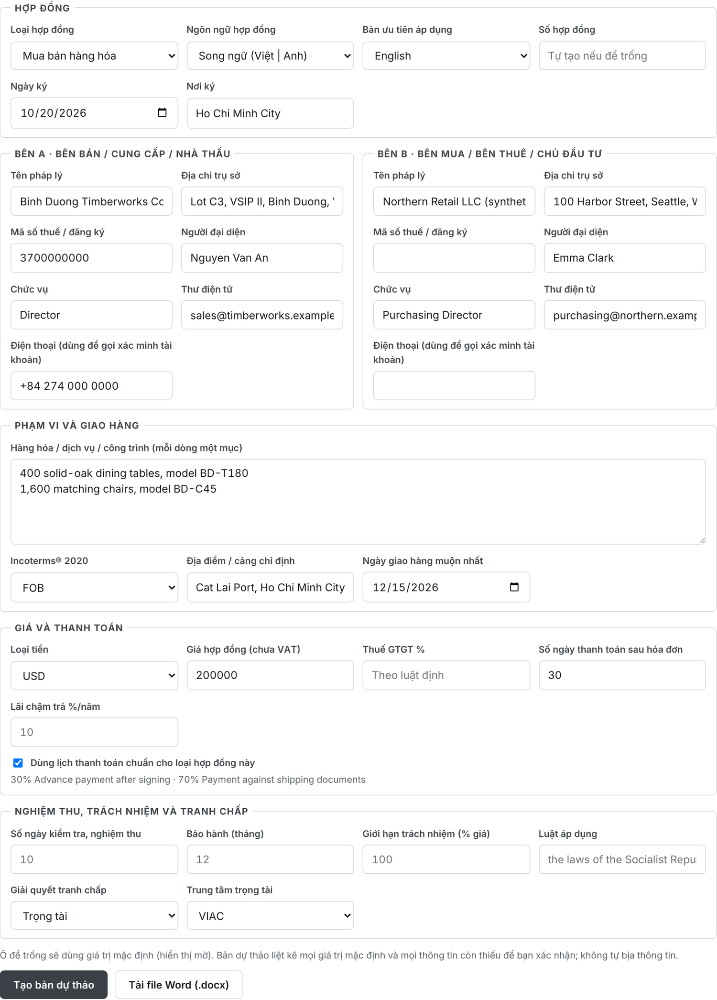
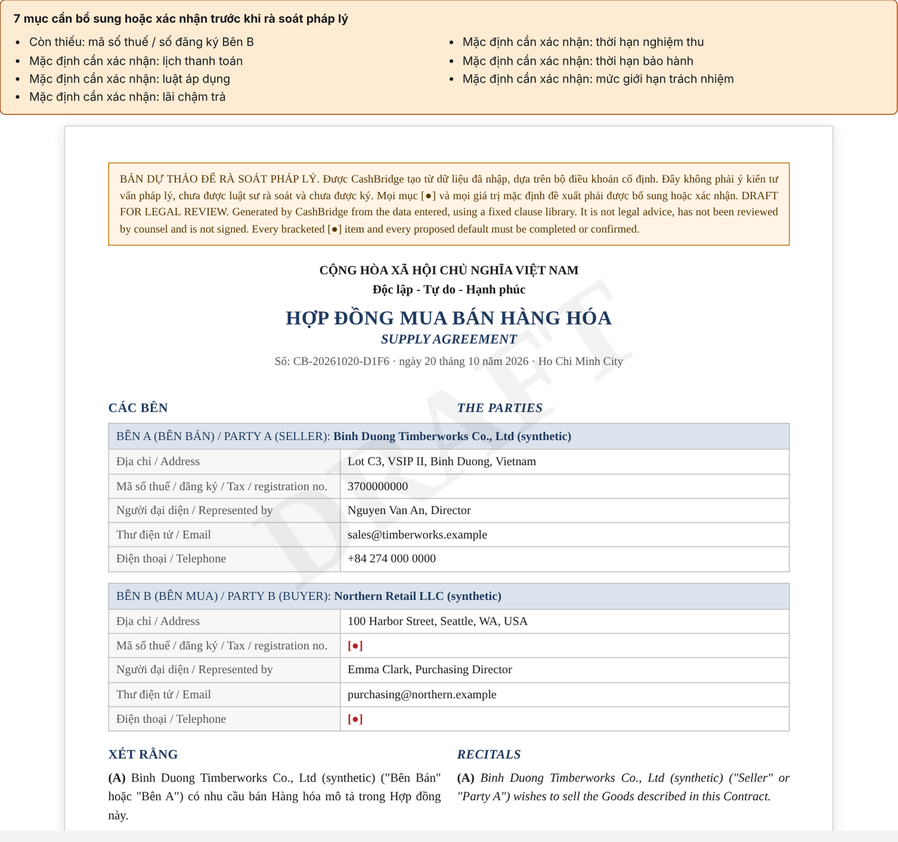
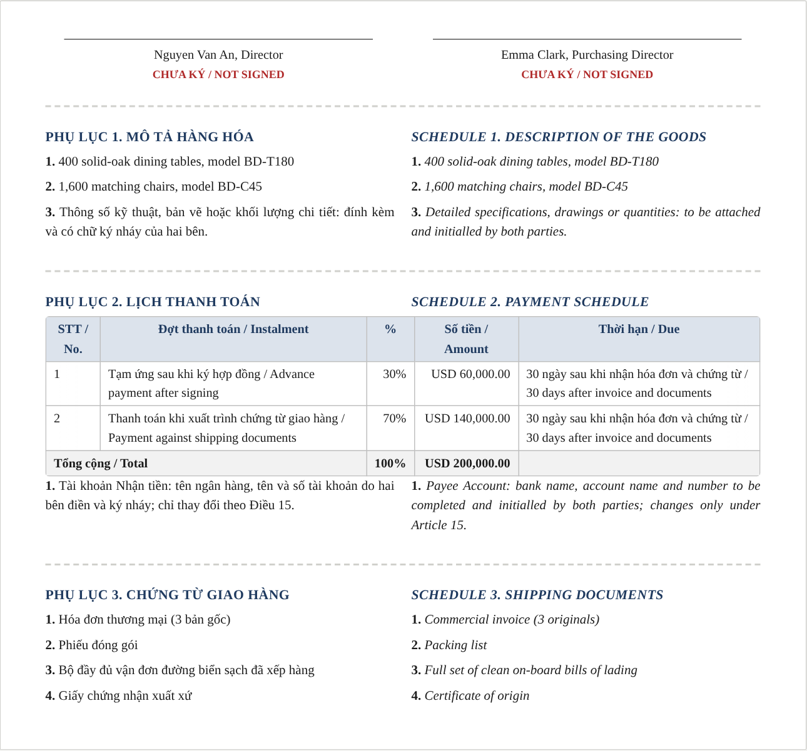
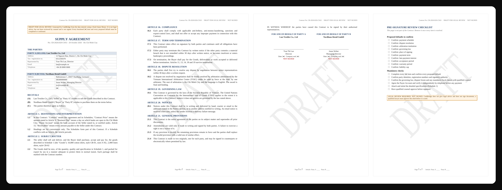
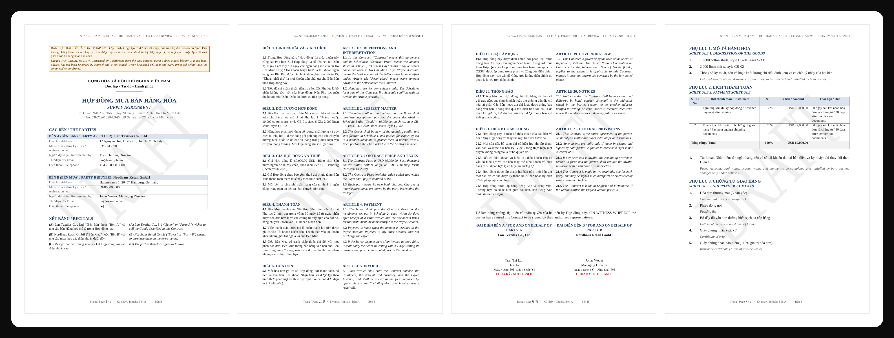
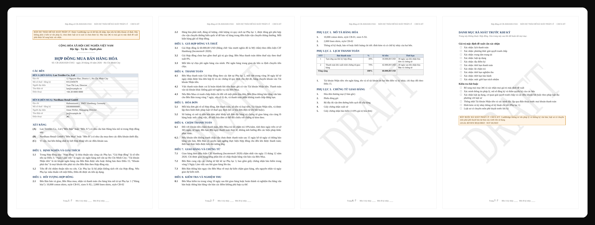
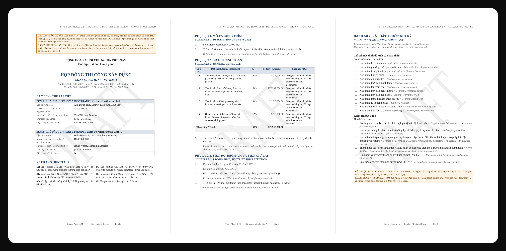

# Contract drafting (v9.1)

> **Tóm tắt (VI):** CashBridge soạn hợp đồng mua bán hàng hóa, dịch vụ và thi công từ một **bộ điều khoản cố định**
> (không dùng mô hình ngôn ngữ): 21 điều + 3 phụ lục + phần chữ ký, bằng tiếng Anh, tiếng Việt hoặc song ngữ hai cột,
> số tiền viết bằng chữ đúng cách đọc trên hóa đơn Việt Nam. Xem trước ngay trong app và tải **file Word có định dạng**
> (A4, Times New Roman, điều khoản đánh số, bảng, dấu chìm DRAFT, "CHƯA KÝ", số trang, danh mục rà soát). Thông tin
> thiếu hiện **[●]**, giá trị mặc định được liệt kê để xác nhận; không có gì được bịa ra. Đây là **bản dự thảo cho luật
> sư**, không phải tư vấn pháp lý, và CashBridge không bao giờ ký.

## What the user sees

**1. The form** (Contracts › 2). Contract type, language (English, Vietnamese, bilingual with a prevailing version),
number, date and place; both parties (legal name, address, tax/registration number, representative, position, email,
telephone used for the account call-back); scope (one item per line); type-specific delivery terms; price, currency,
VAT, payment days, late interest and the payment schedule (standard per type, or edited instalment by instalment with a
live 100% check); acceptance, warranty, liability cap, governing law and the dispute forum. Fields left empty show their
default as a placeholder.



**2. The preview**: the open items first (what is missing, which defaults to confirm), then the contract laid out like
the Word file. Bilingual drafts put each clause next to its translation.





**3. The Word file** (`Download Word (.docx)`): the same contract, formatted for printing and redlining.

English supply agreement: page 1 (notice, parties, recitals, first articles), page 4 (articles 16-21), page 5
(signature blocks), page 7 (pre-signature review checklist, not part of the contract):



Bilingual (Vietnamese | English side by side): page 1, page 2 (articles 1-5), page 6 (articles 19-21 and signatures),
page 7 (schedules):



Vietnamese only, with the national motto, amounts as "60.000,00 USD (Bằng chữ: Sáu mươi nghìn đô la Mỹ chẵn)":



Construction contract (bilingual): retention, performance security and the defects-liability period carried into the
payment schedule and Schedule 3:



## The clause library

| # | Article | Notes |
|---|---|---|
| 1 | Definitions and interpretation | Contract Price, Business Day, Payee Account, Receivables |
| 2 | Subject matter / Services / The Works | Type-specific; scope from the form, detail in Schedule 1 |
| 3 | Contract price and taxes | Amount in figures **and in words** (EN and VI); Incoterms rule for supply; VAT stated or "as required by law" |
| 4 | Payment | Instalments of Schedule 2, payment days, discharge only by credit to the Payee Account, disputed part of an invoice |
| 5 | Invoices | Form required by tax law (incl. e-invoices); quantities match PO and delivery documents |
| 6 | Late payment | Interest p.a. (daily, 365-day basis); suspension after 15 days' notice |
| 7 | Delivery and documents / Performance and personnel / Execution of the works | Incoterms® 2020 + named place + date; shipping documents in 5 Business Days (insurance certificate for CIF/CIP); performance security for construction |
| 8 | Inspection and acceptance | Inspection period; written acceptance or specific non-conformities; deemed acceptance |
| 9 | Risk and title / Intellectual property / Taking-over | Type-specific |
| 10 | Warranty | Months after acceptance (defects period for construction); repair, replace, re-perform or refund |
| 11 | Limitation of liability | Cap as % of price; no indirect loss; carve-outs (fraud, wilful misconduct, injury, the price itself, what law forbids limiting) |
| 12 | Force majeure | 7-day notice, mitigation, no excuse for money already due, termination after 90 days |
| 13 | Confidentiality and data protection | 3 years; disclosure to advisers and financiers allowed; personal data per applicable law |
| 14 | **Assignment of receivables and financing** | The supplier may assign its receivables to a bank or factor **without buyer consent**; after notice the buyer pays only the notified account; no set-off of unrelated claims. Without this, the invoice cannot be financed. |
| 15 | **Payee account security** | A change of payee account takes effect only after a telephone call-back to a number **in the contract** (not in the notice) and 5 Business Days: the standard defence against business-email-compromise fraud |
| 16 | Compliance | Anti-bribery, AML, sanctions, export control |
| 17 | Term and termination | Material breach not remedied in 30 days, insolvency; payment for accepted work; survival |
| 18 | Dispute resolution | Negotiation, then arbitration (VIAC, SIAC, HKIAC or CIETAC, seat and language) or courts |
| 19 | Governing law | Default Vietnamese law (listed as a default to confirm); supply contracts state the CISG position |
| 20 | Notices | Hand, courier, email; when an email notice counts as received |
| 21 | General provisions | Entire agreement, amendments, waiver, severability, originals and e-signature, language precedence (bilingual) |

Schedules: **1** description of the goods / services / works; **2** payment schedule (table: instalment, %, amount,
due) and the Payee Account to be completed and initialled; **3** shipping documents (supply), deliverables and
acceptance criteria (services), or programme, security and retention (construction).

## Rules that keep it honest

- **No invention.** Missing party data, the Incoterms named place, delivery or completion dates become **[●]** and are
  listed as "Enter: …". Every value the user did not enter (payment schedule, law, forum, interest, periods, caps) is
  listed as "Confirm proposed default: …" in the app and on the checklist page of the Word file.
- **Money is exact.** Instalments are computed in cents and the last one takes the rounding remainder, so the schedule
  always adds up to the price (`33.33 + 33.33 + 33.34 = 100.00`).
- **Vietnamese numbers read as on invoices**: 1015 → "một nghìn không trăm mười lăm", 20001 → "hai mươi nghìn không
  trăm linh một", "mốt" and "lăm" where they belong (`contracts/words.py`).
- **Input is data, never instructions.** Every field is length-bounded, control characters are refused, and the text is
  inserted into fixed sentences. An instruction pasted into the scope stays visible in the draft and the contract
  analyzer flags it when the draft is read back.
- **Never signed.** Status `UNSIGNED_DRAFT_REQUIRES_LEGAL_REVIEW`; the Word file carries a DRAFT watermark, a "DRAFT FOR
  LEGAL REVIEW · NOT SIGNED" header on every page, "NOT SIGNED" under each signature line and a review checklist.
- **The analyzer agrees with the drafter.** All 9 combinations (3 types × 3 languages) read back with **0 flags** and a
  100% payment schedule (`test_every_type_and_language_is_complete_and_passes_our_own_analyzer`).

## API

```http
POST /api/contracts/draft        {"data": {...}}  → draft (text), document (blocks), open_items, milestones, status
POST /api/contracts/draft-docx   {"data": {...}}  → formatted .docx (Content-Disposition: attachment, Cache-Control: no-store)
```

```json
{"data": {
  "contract_type": "supply", "language": "bilingual", "prevailing_language": "en",
  "supplier": {"name": "Lan Textiles Co., Ltd", "address": "12 Nguyen Hue, HCMC", "tax_id": "0312345678",
               "representative": "Tran Thi Lan", "title": "Director", "email": "lan@example.vn", "phone": "+84 28 0000 0000"},
  "customer": {"name": "Nordhaus Retail GmbH", "address": "Hafenstrasse 1, Hamburg"},
  "scope": "10,000 cotton shirts, style CB-01\n2,000 linen shirts, style CB-02",
  "currency": "USD", "amount": 60000, "incoterm": "CIF", "incoterm_place": "Hamburg", "delivery_date": "2026-12-15",
  "milestones": [{"event": "Advance payment after signing", "event_vi": "Tạm ứng sau khi ký", "percentage": 30},
                 {"event": "Payment against shipping documents", "percentage": 70}],
  "dispute": "arbitration", "arbitration_institution": "VIAC"
}}
```

Parties can also be plain names (older clients). Types: `supply`, `services` (`start_date`, `end_date`),
`construction` (`site`, `completion_date`, `retention_pct`, `performance_security_pct`, `defects_months`).
Currencies: USD, EUR, CNY, JPY, VND. Both routes need an SME session with `sme:analyze`; `/draft` is written to the hash-chained audit log (input and output hashes, not the text).

## Files and tests

| File | Purpose |
|---|---|
| `contracts/drafting.py` | Validation, defaults and open items, the clause library (EN + VI), plain-text rendering |
| `contracts/words.py` | Amounts in words (EN/VI), number and date formats |
| `contracts/docx_export.py` | Word rendering (python-docx): page setup, header/footer fields, watermark, tables, bilingual columns, checklist page |
| `contracts/intelligence.py` | `draft()` delegates to the drafter; the analyzer (line-level instruction scan, schedule-line milestones, Vietnamese wording) |
| `frontend/src/features/contracts/DraftPanel.tsx`, `ContractPreview.tsx` | Form, milestone editor, open items, paper-style preview (EN / VI / 中文 UI) |
| `tests/test_contract_drafting.py` (24), `tests/test_contract_word_export.py` | Words, completeness × 9, cent-exact schedules, financing/BEC clauses, open items, refusals, injection, Word layout in 3 languages |

## Limits

Not legal advice and not reviewed by a lawyer. No jurisdiction-specific mandatory clauses (for example rules for
contracts with state entities, licensing or public procurement), no clause negotiation history, no e-signature.
Enforceability of an assignment without the debtor's consent depends on the governing law and must be confirmed by
counsel, as the checklist says.
