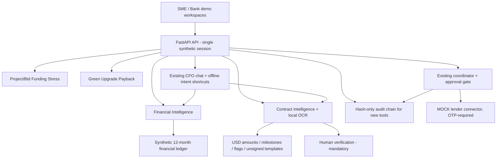

> **Architecture changed:** The privacy-first update supersedes references below to unauthenticated bank API and future free-form LLM orchestration. See [PRIVACY_FIRST_AGENT_ARCHITECTURE.md](PRIVACY_FIRST_AGENT_ARCHITECTURE.md). The bank API now requires a configured Bearer token. LLM orchestration is intentionally disabled and not a target for this design.

# CashBridge 2026 — SME Finance + Contract Intelligence extension

**Submission status:** runnable, synthetic, offline demonstration. These features add to the original 13-week forecasting, invoice matching, buyer risk, financing APR, evidence pack, OTP, audit, Green Finance and Capital Planner workflows.

## Product / roles

**SME workspace:** working-capital health → financial EDA and budget planning → assess new bids / workforce cost → extract contracts / invoices, review payment clauses and generate an **unsigned** agreement draft → compare financing options → Director OTP pack approval.

**Bank reviewer preview:** read the same source-labelled finance indicators, funding options, green-document completeness, and contract review flags. **No authenticated multi-tenant bank portal, KYC verification or actual bank underwriting exists.** Switching the UI role only changes the display; production must add a real identity provider, scoped server-side RBAC/ABAC, encryption at rest and independent credit policies.

## New deterministic engines

**Calculation boundaries:** No LLM executes arithmetic, supplies an authoritative contract opinion or makes a lending decision. Rule-based detection flags suspicious patterns but **does not establish fraud**. OCR text is untrusted, no extracted instructions are executed, and uploads are memory-only.

### Financial formulas

| Function | Formula / convention | Important qualification |
|---|---|---|
| Current ratio | current assets / current liabilities | Null if liabilities = 0 |
| Quick ratio | (current assets − inventory) / current liabilities | Excludes stock |
| Cash ratio | cash / current liabilities | Short-term liquidity snapshot |
| Gross margin | (revenue − COGS) / revenue | Uses synthetic annual P&L |
| EBITDA | revenue − COGS − operating expenses | Inputs exclude depreciation |
| Interest cover | EBIT / interest | Null if interest = 0 |
| DSCR proxy | EBITDA / (annual principal + interest) | **Not** covenant DSCR or CFADS |
| Debt/equity | total interest-bearing debt / book equity | Book rather than market values |
| Cash runway (gross) | cash / average monthly expenses | Assumes zero receipts |
| Marketing scenario | monthly cash in − (monthly cash out + incremental marketing + interest) | Average of 12 synthetic months; no marketing ROI |
| Project cash gap | max(0, upfront cost − advance received − deployable cash) | Project payment waterfall simplified |
| Bid stress | max(0, upfront cost × (1 + overrun) − deployable cash) | Assumes delayed advance entirely |
| Workforce cost | max(0, required team hours − available team hours) × outsource hourly rate | Aggregated capacity only, no individual scores |
| Green simple payback | project cost / (yearly saved kWh × assumed tariff − yearly operating cost) | Excludes taxes, discounting and financing |

EDA supplies monthly revenue, expenses, marketing, payroll, supplier spending, median expenses and z-score expense outliers (absolute z ≥ 2). **An outlier is not fraud evidence.** No trained ML fraud classifier is claimed.

### Contract workflow

- **Extract:** `POST /api/contracts/extract-upload` accepts `.txt`, text PDFs, scanned PDFs (local OCR), and `.png` / `.jpg` / `.jpeg`; 5 MB / 10-page limit. `PyMuPDF` reads PDF text; local Tesseract OCR is used when text extraction is insufficient; user must review all results.
- **Analyze:** `POST /api/contracts/analyze` extracts explicit USD amounts, percentage-bearing payment lines, invoice IDs and tax IDs. Flags payment milestone totals not equal to 100%, text-based beneficiary changes, ambiguous clauses, missing termination wording, invoice amount inconsistencies, and instruction patterns. These are **review prompts, not verified allegations**.
- **Reconcile:** `POST /api/contracts/reconcile` compares explicit USD amounts in contract and invoice; cannot verify actual document provenance or external financing records.
- **Draft:** `POST /api/contracts/draft` generates a **deterministic template-assisted, unsigned draft** in supply / services / construction services format, with validated milestone math and a legal-review checklist. It is not an attorney or specialized legal drafting engine. `.txt` export / copy are implemented in UI; `.docx` generation is not implemented.

**Bank controls:** existing invoice registry demonstrates anti-duplication inside the local demo, not across institutions. The existing Director pack approval still requires action-bound OTP. New internal tools are separately audit-logged with input/output hashes and do not submit to a lender.

## Endpoints & status

| Endpoint | Method | Purpose |
|---|---|---|
| `/api/analytics/summary` | GET | Source-labelled financial ratios + 12-month EDA |
| `/api/analytics/scenario` | POST `{ "data": { "marketing_increase_pct":25, "receipts_delayed_pct":10 } }` | Deterministic funding/budget impact |
| `/api/projects/assess` | POST `{ "data": { "contract_value_usd":200000, "upfront_cost_usd":110000, "available_cash_usd":60000 } }` | Bid funding gap, stress, team capacity |
| `/api/contracts/extract-upload` | POST `multipart/form-data` | Local text extraction and OCR |
| `/api/contracts/analyze` | POST `{ "text": "..." }` | Payment term and fraud **signals** |
| `/api/contracts/draft` | POST `{ "data": {...} }` | Unsigned legal template |
| `/api/contracts/reconcile` | POST `{ "data": { "contract_text":"...", "invoice_text":"..." } }` | Cross-document amount check |
| `/api/bank/review` | GET | Synthetic bank reviewer preview, not access control |
| `/api/green-finance/economics` | POST `{ "project_id":"GREEN-SOLAR-001", "electricity_price_usd_per_kwh":0.12, "annual_opex_usd":1500 }` | Synthetic green upgrade payback |

Existing endpoints and security tests are retained. `/docs` provides up-to-date OpenAPI descriptions.

## Distribution and verification

- The web app (`frontend/`, built into the committed `frontend/dist`) supports the main SME/bank workflows, including the new APIs, OCR, scenario forms, contract drafting, funding pack and OTP actions. It uses local system fonts and makes no external requests. Start with `make run`; no Node needed to run it.
- `make test` runs the legacy suite plus new endpoint / math / input-validation / OCR / risk and approval-safety tests. Requires packages in `requirements.txt` and local `tesseract-ocr` for scanned OCR.
- The original suite and new Python tests ran successfully in the packaging environment. The web UI was also exercised with Chromium/Playwright using mocked browser fetch calls bound to the in-process FastAPI test client: navigation, financial scenario, contract review/reconciliation/draft and bank reviewer preview completed without browser JavaScript errors. Screenshots are included in `docs/screenshots/06-*.png` through `09-*.png`. This is **not** an end-to-end deployment or network-connected React build verification; the optional React source was syntax-checked but not fully bundled in this offline environment.

## Evaluation coverage (organizer weights, NOT predicted judging points)

| Judging category | Demonstrable evidence | Further work before production |
|---|---|---|
| Task Completion (40%) | Contract → cash model → budget & bid stress → funding alternatives → OTP evidence pack | Real bank/ERP integration; signed contracts; accurate project cash-flow schedules |
| Security & Compliance (30%) | Existing audit chain, permission gate for external submissions, PII masking, OTP, replay control, upload bounds, untrusted-document flags, all synthetic | Real auth/RBAC, tenant isolation, TLS, secrets vault, proper document retention and jurisdiction review |
| Innovation & Interaction (30%) | SME/bank dual-view demo, explainable financial EDA, contract drafting & risk flags, conversational tool shortcuts, marketing and green scenarios | Free-form natural language action plans; full live agent orchestration; ML anomaly calibration |

## Next steps prioritized

1. Before final submission: run demo from a clean Python environment, record actual video (including error/permission refusal), add team attribution/license checks, and ensure competition submission packaging meets its terms.
2. For the next milestone: React build with Node 20+, UI/E2E screenshot tests; invoice budget ledger ingestion; richer payment milestone parser and source-page citations; DOCX contract draft export with legal clause library.
3. Before any real SME/bank data: authenticated roles, tenant isolation, security review, OCR adversarial tests, encryption, real financial statements, model validation and institution-specific credit rules.
